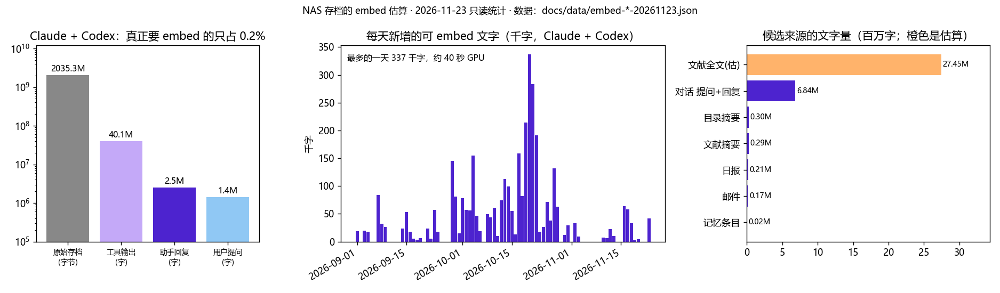

# 向量检索：基建现状与后续计划

> 2026-11-23。分支 `feature/embed`，本机 worktree 在 `D:\ametyping-embed`。
> 向量服务已经部署并验证（见 [embedding-service.md](embedding-service.md)），**NAS 上还没有任何东西被向量化**。
> 这份文档是给接手的人的：现有的基建、实测的数据量、建议的设计，以及按阶段拆好的工作和验收标准。
> 第 3 节的设计是建议，第 7 节列出的事项需要用户拍板。

## 0. 一页摘要

- **服务**：remote3090（RTX 3080 10 GB）上跑 Qwen3-Embedding-4B，`http://192.168.114.3:8090/v1/embeddings`，约 5000 token/s，单条查询 22 ms。
- **数据量很小**：全部对话里值得 embed 的（提问和回复，去掉噪声）约 **480 万字，约 1.8 万块，约 280 万 token**。全量算一遍约 **10 分钟**；1024 维 float32 存下来约 **75 MB**。
- **增量也很小**：最忙的一天约 34 万字（Claude + Codex），约 40 秒 GPU。不需要每天定点跑，跟着搜索索引增量更新就行。
- **只在 NAS 存一份**：向量是派生数据，丢了 10 分钟重建，remote3090 不存任何状态。
- **不需要向量扩展**：NAS 上 Node 22 在内存里暴力搜 2.4 万条 1024 维向量只要 85 ms（实测），第一阶段不引入 sqlite-vec。
- **建议顺序**：对话混合检索 → 记忆条目去重 → 文献摘要和笔记 → 文献全文 → 其他。

## 1. 已有的基建

| 东西 | 位置 | 状态 |
|---|---|---|
| 向量服务 | remote3090 `D:\ame-embed`，计划任务 `AmeEmbed`（SYSTEM，开机自启，挂了 10 秒内自动拉起） | 运行中，已验证正确性和鉴权 |
| 部署脚本 | `remote/deploy/embed-win/`（和 remote3090 上的逐个比对过 SHA-256） | 已提交 |
| 密钥 | NAS `/volume2/docker/ame-remote/secrets/embed-remote3090.key`（600 权限） | 调用时用 `Authorization: Bearer` |
| NAS Python 环境 | `/volume2/docker/ame-embed/miniforge3/envs/ame-embed/bin/python`：Python 3.12、numpy、requests、sqlite-vec | 已装；只用于脚本和试验，服务端是 Node |
| NAS Node | `/var/packages/Node.js_v22/target/usr/local/bin/node`（v22.23），`node:sqlite` 可用，支持 `loadExtension` | 看板服务本身就跑在它上面 |
| 测试和估算工具 | `tools/embed-bench.py`（正确性和压测）、`tools/embed-estimate.py`（存档数据量，只读）及两个作图脚本 | 已提交 / 本分支 |
| 拓扑图 | remote3090 已接入“网络与设备”，向量服务显示为“向量服务 (llama-server :8090)” | `/health` 不要密钥，可以直接做存活检查 |

调用约定（细节见 embedding-service.md 第 3 节）：

- **查询**前面加指令：`Instruct: Given a search query, retrieve relevant passages from coding-agent conversations and notes\nQuery:<查询>`；**文档**不加任何前缀。同一个索引里指令文字要固定。
- 返回 2560 维、已归一化的向量。只取前 1024 维时要**重新归一化**。
- 单条输入上限 4096 token；一次请求建议 16～32 条。

## 2. 数据量估算（2026-11-23 实测）



数据：[data/embed-estimate-20261123.json](data/embed-estimate-20261123.json)（扫描 Claude 和 Codex 原始记录）、[data/embed-sources-20261123.json](data/embed-sources-20261123.json)（其他来源的计数）。全部是只读统计。重新生成：

```bash
ssh nas '/volume2/docker/ame-embed/miniforge3/envs/ame-embed/bin/python - --db /volume2/docker/ame-remote/remote/server/data/knowledge.sqlite --key /volume2/docker/ame-remote/secrets/embed-remote3090.key' < tools/embed-estimate.py > docs/data/embed-estimate-<日期>.json
python tools/embed-estimate-plot.py docs/data/embed-estimate-<日期>.json docs/data/embed-sources-<日期>.json docs/img/embed-estimate.png
```

### 2.1 对话

| 量 | 数值 | 说明 |
|---|---|---|
| 完整存档 `knowledge.sqlite` | 2.6 GB，684 个源文件 | 2026-05 起，10、11 月占了大头 |
| 其中 Claude + Codex 原始记录 | 2035 MB | 占全部存档字节的 88% |
| 其中提问 + 回复的文字 | 390 万字（提问 140 万，回复 250 万） | **约占原始字节的 0.2%**。其余是工具输出（4000 万字）、思考过程、请求记录、图片 base64 和 JSON 外壳 |
| 看板 `search.db` 的 `lines` 表（5 种工具、5 台机器） | 提问 + 回复 684 万字，1.74 万行 | 2026-08-26 起 |
| 其中噪声 | Codex 注入的 `<skill>` 技能说明 180 万字；压缩摘要 21 万字；`<image>` 等 6 万字；完全重复的 912 行 | 见 3.6 节清洗规则 |
| **清洗后** | **约 480 万字** | |
| 每字 token 数 | 0.59（38 段样本，经服务的 `usage` 实测；样本小，中文多） | 英文文本约 0.25～0.3 |
| 折合 | 约 280 万 token，约 1.8 万块（600 字一块） | |
| 全量计算时间 | 约 10 分钟（5000 token/s） | |
| 存储（1024 维 float32） | 约 75 MB；2560 维约 185 MB；1024 维 int8 约 19 MB | |

增长（Claude + Codex，按记录里的时间戳）：

| 时段 | 可 embed 文字 |
|---|---|
| 2026-10（最忙的月） | 259 万字 |
| 最近 30 天 | 66 万字，有记录的 20 天，平均每天 3.3 万字 |
| 最忙的一天 | 34 万字 ≈ 20 万 token ≈ 40 秒 GPU |

把 Claude + Codex 换算到全部工具（按 `lines` 表的比例乘 1.7），**按 10 月的速度，一年约 5000 万字、20 万块、800 MB（1024 维 float32）**。最近的速度只有它的一半不到。

### 2.2 其他来源

| 来源 | 位置 | 量 | 说明 |
|---|---|---|---|
| 三层记忆条目 | `knowledge.sqlite` `memory` | 47 条，2.1 万字 | 很小，价值高 |
| 研究目录摘要 | `research_directory_summaries` | 35 条，30 万字 | |
| 日报 | `search.db` `docs`（report） | 52 篇，21 万字 | |
| 邮件 | `search.db` `docs`（mail） | 71 封，17 万字 | |
| Zotero 条目 | `literature/zotero.json` | 457 条，356 条有摘要（29 万字）；笔记 135 条，批注 229 条 | 摘要多为英文 |
| 文献全文 | `/volume1/zotero` 549 个附件（1.3 GB）；已抽文字的只有 9 篇（`literature/text/`） | **估算**：每篇约 5 万字 → 约 2700 万字，约 700～800 万 token（英文），约 25 分钟 GPU；按 1500 字一块约 1.8 万块、75 MB | 抽文字靠 `fulltext.js`（pdftotext），扫描版没有文字层 |
| 每日推送候选 | `literature/feed.json`、`feed-inbox.json` | 已看过 3033 篇，候选还在累积 | 标题加摘要 |

**结论**：加上文献全文，总量也在 10 万块以内，向量库不到 0.5 GB。存储和算力都不是约束，设计可以从简。

## 3. 设计（建议）

### 3.1 存在哪：只在 NAS 存一份

向量是派生数据：原文、模型、量化方式、维数、指令定了，结果就是确定的，丢了 10 分钟重建（含文献全文约 40 分钟）。所以：

- 放在 NAS 的 `remote/server/data/vectors.sqlite`（volume2 SSD），**不放进 `knowledge.sqlite`**：主库不能删，向量库要能随时整个删掉重建。
- remote3090 只负责计算，不存状态。以后换显卡、换机器，只要改一个地址。
- 备份交给 NAS 的快照，不另外复制。

### 3.2 什么时候算：跟着搜索索引增量做，不定点

`search.db` 的 `lines` 表本来就会按文件增量追加（`search-index/lines.js`）。向量任务读它新增的行就行：

- 每 5～10 分钟一轮（或者在 `lines` 追加完成时通知），先查 `/health`，服务不在线就跳过这一轮，下次补。
- 每天凌晨跑一次一致性检查：有没有漏算的、有没有指向已删除内容的。
- 换模型、换维数、换指令、换切块规则时，`meta` 表里的版本对不上，整库重建。

按 2.1 节的增长速度，每轮只有几十块，几秒钟算完。

### 3.3 怎么存、怎么搜：先不用向量扩展

实测（NAS，Ryzen V1500B，Node 22，`Float32Array` 逐条点积加全排序）：

| 规模 | 内存 | 一次查询 |
|---|---|---|
| 2.4 万 × 1024 | 98 MB | 85 ms |
| 10 万 × 1024 | 409 MB | 296 ms |
| 10 万 × 512 | 204 MB | 172 ms |

NAS 有 32 GB 内存（可用约 19 GB）。所以第一阶段：

- 向量以 float32 BLOB 存在 `vectors.sqlite` 的普通表里，服务启动时载入内存，查询时暴力点积，取前 50。
- 不引入 sqlite-vec，不加原生依赖。超过约 20 万块、或者单次查询超过 0.5 秒时，再考虑换成 sqlite-vec（`node:sqlite` 支持 `loadExtension`，NAS 的 Python 环境里也已经有它）或 int8 存储。
- 存 1024 维。按 3.1 节的量，存 2560 维也负担得起；存全维的好处是以后换维数不用重算，要不要这样由接手的人定。

### 3.4 对话文本从哪取：`search.db` 的 `lines` 表

不建议自己去解析 `knowledge.sqlite` 里的原始记录：五种工具格式各不相同，而且每种还在变。`lines` 表已经是看板统一过的结果，每行有 `machine / session / t / role / file / text`，5 种工具、所有机器都有，关键词搜索也用的是它。`tools/embed-estimate.py` 自己解析原始记录，只是为了估算 Claude 和 Codex 的比例。

只取 `role` 为 `user` 和 `assistant` 的行。

### 3.5 用什么作键：文本哈希，不用行号

`search.db` 是可以随时重建的索引，重建后 `rowid` 会变。所以：

- 向量按**清洗后文本的 SHA-256**存，同样的文字只算一次（同一会话出现在两个项目目录下的情况，实测确实有）。
- 另建一张表记“这段文字出现在哪里”：`(hash, machine, session, t, role, file)`，一段文字可以对应多处。
- 搜索结果返回 `(machine, session, t)`，和关键词搜索的结果用同一套定位方式合并，前端能直接跳转。

### 3.6 清洗规则（实测发现的噪声）

| 规则 | 依据 |
|---|---|
| 去掉 Codex 的 `<skill>…`、`<recommended_plugins>…`、`<image>…` 行 | `lines` 里 `<skill>` 有 92 行、180 万字，是 Codex 每轮注入的技能说明，不是用户写的 |
| 去掉以 `This session is being continued from a previous conversation` 开头的行 | Claude 压缩上下文后插入的摘要，14 条 21 万字，内容和原文重复 |
| 删掉 `<system-reminder>…</system-reminder>` 片段 | 只有 2 条，但要防 |
| 少于 8 个字的行不算（“ok”“继续”） | 490 行，没有检索价值 |
| `<pasted_content>`、`<agent-message>`、`<cross-session-message>` **保留** | 用户贴进来的材料和 AmeMesh 的消息是有用的；可以在定位表里标出类型 |

规则写成一个纯函数，配上单元测试，用上面这些实际样本做测试数据。

### 3.7 切块

- 600 字以内的一行就是一块。实测提问和回复的长度中位数只有 67 字，90% 在 884 字以内。
- 更长的按段落切成约 600 字一块，相邻块重叠一句；最长的单条有 3.6 万字。
- 文献全文用更大的块（约 1500 字，英文约 400 token），按页记录位置，方便跳到 PDF 的对应页。

### 3.8 查询和排序

- 关键词：现有的 `search-index`（FTS5）。注意它现在**按时间或行号排序，没有用 `bm25()`**（`search-index/docs.js` 的 `ORDER BY t DESC`、`lines.js` 的 `ORDER BY rowid DESC`）；混合排序要用到关键词这一路的名次，最好顺手加上 bm25。
- 向量：查询文本加指令后调服务，取前 50。
- 合并：RRF。每条结果的得分是 Σ 1/(60 + 在各路中的名次)。不需要调权重，也不怕两路分数的尺度不同。
- 服务不在线时（`/health` 不通或超时 2 秒），只用关键词，界面上标明“语义检索暂不可用”，不报错。

### 3.9 和 remote3090 的配合

- 建索引用 1 个并发、每批 16 条，给查询留出服务的另外 3 个并行槽。
- 查询请求的超时设 2 秒，建索引的超时设 120 秒。
- remote3090 关机时，建索引任务暂停，积压留到它上线后再补。

## 4. 工作计划

每个阶段单独可用、单独验收，做完一段再决定下一段。

### 阶段 1：对话的混合检索（核心）

建议的模块（放在 `remote/server/embed/`，沿用 `search-index/` 的写法：依赖注入、`node:sqlite`、不加 npm 依赖）：

| 文件 | 内容 |
|---|---|
| `client.js` | 调服务：`embed(texts)`、`embedQuery(q)`、`health()`；超时、重试、截维加归一化 |
| `clean.js` | 3.6 节的清洗规则和 3.7 节的切块，纯函数 |
| `store.js` | `vectors.sqlite`：`meta`（模型、量化、维数、指令、规则版本）、`vec(hash PRIMARY KEY, dims, vec BLOB, text)`、`refs(hash, machine, session, t, role, file)`、`cursor`；启动时载入内存 |
| `job.js` | 增量任务：读 `lines` 新增行 → 清洗、切块 → 跳过已有的哈希 → 分批调服务 → 写库；凌晨的一致性检查 |
| `search.js` | `query(q, k)` 返回带名次的结果，供 `summary/search.js` 做 RRF 合并 |

配置放进服务端的 `config.json`，比如 `"embed": { "url", "keyFile", "dims": 1024, "every": "10m" }`；不配置就整个功能不启用，看板行为和现在一样。

验收：

1. **评测集**：请用户写 30 个真实会问的问题，每个注明想找到的会话。比较只用关键词和混合排序的前 10 名命中率（recall@10）。混合排序要明显更好，而且不能把关键词一下就能命中的问题弄丢。评测数据和结果存成 JSON，放进 `docs/data/`。
2. 全量建库时间、每轮增量时间、单次查询耗时（含网络往返和暴力搜索），记进文档。
3. 关掉 remote3090 上的服务，看板搜索照常可用，只是退回关键词搜索。
4. 删掉 `vectors.sqlite` 后能自动重建。

### 阶段 2：记忆条目

- 记忆条目（目前 47 条）和 `memory_observed` 里各台机器观察到的规则文本都算向量。
- 用途一：审阅时提示“这一条和某一条意思很接近”（例如相似度 > 0.85 的条目对），作为现有 API 智能去重的预筛，减少大模型调用。
- 用途二：按当前问题挑出最相关的几条记忆，给以后的对话型功能用。
- 验收：拿历史上真实合并过的条目（`memory_review_applies` 里有记录）检验，看预筛能不能把它们找出来。

### 阶段 3：文献摘要、笔记和批注

- Zotero 条目的标题加摘要、用户的笔记和批注。约 1000 段，1 分钟算完。
- 用途：文献库语义搜索；“和这篇相关的”；每日推送的候选先用“候选和画像里各条研究问题的相似度”预筛，再交给大模型打分，减少调用次数（`literature/feed.js` 现在是先按画像的关键词预筛）。
- 多数摘要是英文、用户的问题是中文，正好用上跨语言检索。2026-11-23 的小试验里，英文查询“mesh refinement convergence”排第一的就是中文的“网格加密……收敛”。
- 验收：用户挑 10 篇“我知道它和某个问题有关”的论文，看能不能排进前 10。

### 阶段 4：文献全文

- 依赖 `fulltext.js` 先抽出文字，目前只抽了 9 篇。批量抽取 549 个附件是一项单独的工作，要注意扫描版 PDF 没有文字层。
- 按页切块，结果能跳到 PDF 的对应页。
- 估算约 25 分钟 GPU、约 1.8 万块、75 MB（1500 字一块，1024 维），适合夜里跑。

### 阶段 5：其他（按需）

| 想法 | 做法 |
|---|---|
| 相似报错 | 报错文本单独建一类，遇到新报错时找历史上的类似错误和当时的解法；AmeMesh 看门狗判断“同一个错误”时也可以用相似度代替现在的正则规整 |
| 会话归项目 | 会话第一条提问和各项目描述的相似度，作为自动归类的一个信号 |
| 日报、邮件、研究目录摘要 | 并进混合检索的 docs 一路 |
| AmeMesh 派活 | 阶段推进器（见 [jine-reference.md](jine-reference.md) 3.2 节）按任务内容找做过类似事情的节点 |

不建议做的：源代码（grep 更准）、工具输出和日志（体积大、噪声多）、数据表。

## 5. 已知的坑

| 坑 | 说明 |
|---|---|
| 查询忘了加指令 / 文档误加了指令 | 不报错，只是检索效果变差（官方说差 1%～5%），很难发现。用单元测试锁住 |
| 截维后没重新归一化 | 余弦相似度会算错 |
| 不同模型或维数的向量混在一起 | 不报错，结果是乱的。`meta` 表不匹配时一律重建 |
| 把 `rowid` 当键 | `search.db` 重建后对不上。见 3.5 节 |
| 输入超过 4096 token | 服务直接报错。切块已经保证 600 字左右，但防御性地在 `client.js` 里截断 |
| 服务在 remote3090 上是 SYSTEM 任务，看板 agent 是“登录后启动” | remote3090 重启后没人登录时，向量服务正常，拓扑图上显示离线 |
| `remote3090.local` 先解析成 IPv6，而 IPv6 不通 | NAS 用 IPv4 地址 `192.168.114.3` 调用；建议在 OpenWrt 上给它设固定租约（MAC `e0:d4:e8:7c:79:36`），目前还没设 |
| 群晖缺 `ldd`、`getconf` 等常用工具 | `tools/nas-embed-env.sh` 已处理；装别的东西也会遇到类似问题。不要往系统目录装东西 |
| NAS 没开 SFTP | `scp` 传不了文件，用 `ssh nas 'cat > 路径' < 本地文件` |
| `tokens_per_char` 样本只有 38 段 | 2.1 节的 token 数是估算；阶段 1 全量建库时用服务返回的 `usage` 记下真实值 |

## 6. 估算的前提和不确定性

- 对话文字量按 `lines` 表减去实测的噪声得来，没有逐行跑清洗规则，误差估计在 ±10%。
- 文献全文按每篇 5 万字估算，没有实测。
- 增长速度波动很大：10 月是最近 30 天的 4 倍。
- 只算了中文为主的对话的 token 比例，英文文献的比例偏低，计算时间偏保守。

## 7. 需要用户拍板的

1. **阶段 1 的评测问题**：要用户写 30 个真实问题，这是判断值不值得继续做的唯一依据。
2. **存 1024 维还是 2560 维**：都存得下；2560 维以后改维数不用重算。
3. **搜索界面**：语义结果是直接混进现有的搜索结果，还是加一个开关。
4. **文献全文的批量抽取**要不要做、放在哪个阶段。
5. remote3090 的固定 IP 是否在 OpenWrt 上设置。

## 8. 相关文件

| 文件 | 内容 |
|---|---|
| [embedding-service.md](embedding-service.md) | 服务本身：接口、实测、运维 |
| `tools/embed-estimate.py` | 本文 2.1 节的数据来源（只读扫描 `knowledge.sqlite`） |
| `tools/embed-estimate-plot.py` | 本文的图 |
| `remote/server/search-index/` | 关键词索引，阶段 1 的文本来源和合并对象 |
| `remote/server/summary/search.js` | `/api/search` 的实现，混合排序接在这里 |
| `remote/server/literature/feed.js`、`profile.js`、`zotero/mirror.js` | 阶段 3 的接入点 |
| `remote/server/vault/` | 记忆条目，阶段 2 的接入点 |
