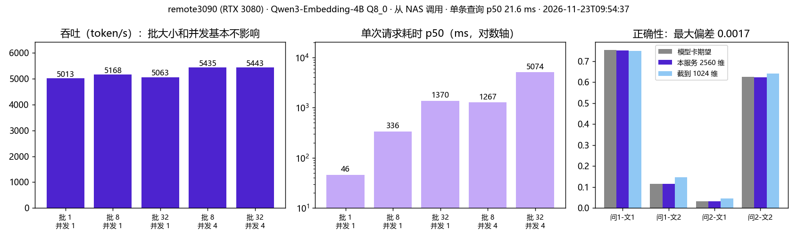

# 向量服务（remote3090）

> 2026-11-23 部署。把文本变成向量，给 NAS 上的语义检索用。服务跑在 remote3090，NAS 中心节点通过局域网调用。
> 目前只部署了服务本身，AmeTyping 的检索流程还没有接入（见第 6 节）。

## 1. 一览

| 项目 | 值 |
|---|---|
| 机器 | remote3090，Windows 11，**RTX 3080 10 GB**（不是 3090），i7-9700K，16 GB 内存 |
| 地址 | `http://192.168.114.3:8090`（DHCP 分配；建议在 OpenWrt 上设成固定租约） |
| 模型 | Qwen3-Embedding-4B，官方 GGUF 的 Q8_0 量化（Apache-2.0），SHA-256 已和 HuggingFace 核对 |
| 向量 | 2560 维，已归一化；可以只取前 1024 维（Matryoshka，取完要重新归一化） |
| 单条输入上限 | 4096 token（约 6000～8000 个汉字）。超过会报错，调用方要先切块 |
| 服务程序 | llama.cpp `llama-server` b12640（CUDA 12.4 版），OpenAI 兼容接口 |
| 鉴权 | `Authorization: Bearer <密钥>`。密钥在 NAS 的 `/volume2/docker/ame-remote/secrets/embed-remote3090.key`（仅本人可读） |
| 访问范围 | Windows 防火墙只放行 192.168.114.0/24 访问 8090 端口 |
| 显存 | 常驻约 6.1 GB（模型 4.3 GB，其余是 KV 缓存和计算缓冲），桌面另占约 0.9 GB |

**为什么选这个模型**：Qwen3-Embedding-4B 的 C-MTEB 是 72.3（0.6B 是 66.3，8B 是 73.8），中英文和代码混合的内容都能处理，许可宽松。2026 年新出的 jina-embeddings-v5、F2LLM-v2 分数也不错，但都是非商用许可。8B 的 Q8 量化要 8 GB，在 10 GB 显卡上太挤。

**为什么用 llama.cpp**：这台机器是原生 Windows，没有 WSL 和 Docker；HuggingFace 的 TEI 没有 Windows 版本。llama.cpp 有官方的 Windows CUDA 构建，加载官方 GGUF 就能用，量化后 4B 模型能装进 10 GB 显存。

## 2. 实测



数据：[data/embed-bench-20261123.json](data/embed-bench-20261123.json)；脚本：`tools/embed-bench.py`（从 NAS 发起，测的是 NAS 实际能拿到的速度）；作图：`tools/embed-bench-plot.py`。

| 指标 | 结果 |
|---|---|
| 正确性 | 模型卡的 4 个示例，相似度最大偏差 0.0017（期望 0.7534 / 0.1147 / 0.0320 / 0.6258，实测 0.7518 / 0.1153 / 0.0314 / 0.6241）。说明量化损失很小，句尾结束符也补对了 |
| 单条查询延迟 | p50 21.6 ms，p95 22.7 ms（含网络往返） |
| 吞吐 | 约 5000～5400 token/s，约 23～25 个 500 字文本块/秒 |
| 无密钥请求 | 401 |
| 自恢复 | 杀掉 llama-server，约 10 秒后自动重启，NAS 随即可以调用 |

测试文本是 NAS 上 `ame-remote/docs` 里唯一的一份文档，切成 500 字的块后重复凑到 512 块，平均每块约 217 token。吞吐主要取决于 token 数，和具体内容关系不大。

吞吐基本不随批大小和并发变化，说明显卡算力已经跑满。批越大，单次请求等得越久，但总速度不变。所以：**查询一条一条发，建索引时每批 8～32 条就够了。**

按这个速度估算：1 亿 token 的文本全量算一遍约 5.5 小时。日常增量没有压力，第一次全量建索引适合放在夜里跑。

## 3. 怎么调用

### 3.1 查询和文档要区别对待

Qwen3-Embedding 是“带指令”的模型：**查询前面加一句任务说明，文档什么都不加。** 不加指令也能用，但官方说检索效果会差 1%～5%。

```
查询：Instruct: Given a search query, retrieve relevant passages from coding-agent conversations and notes\nQuery:那次网格加密的收敛性测试
文档：（原文，不加前缀）
```

指令用英文写（官方建议），可以按用途换说法，但同一个索引里要保持一致。

### 3.2 接口

OpenAI 兼容：`POST /v1/embeddings`

```bash
K=$(cat /volume2/docker/ame-remote/secrets/embed-remote3090.key)
curl -s http://192.168.114.3:8090/v1/embeddings \
  -H "Authorization: Bearer $K" -H "Content-Type: application/json" \
  -d '{"input": ["第一段文字", "第二段文字"]}'
# 返回 {"data":[{"index":0,"embedding":[...2560 个数...]}, ...], "usage":{"prompt_tokens":..}}
```

Python（NAS 的 conda 环境，见第 5 节）：

```python
import numpy as np, requests
URL = 'http://192.168.114.3:8090/v1/embeddings'
KEY = open('/volume2/docker/ame-remote/secrets/embed-remote3090.key').read().strip()
TASK = 'Given a search query, retrieve relevant passages from coding-agent conversations and notes'

def embed(texts, dims=1024):
    r = requests.post(URL, json={'input': texts}, headers={'Authorization': 'Bearer ' + KEY}, timeout=120)
    r.raise_for_status()
    v = np.array([d['embedding'] for d in sorted(r.json()['data'], key=lambda d: d['index'])], dtype=np.float32)
    v = v[:, :dims]                                   # 只留前 dims 维
    return v / np.linalg.norm(v, axis=1, keepdims=True)   # 截短后要重新归一化

def embed_query(q, dims=1024):
    return embed([f'Instruct: {TASK}\nQuery:{q}'], dims)[0]
```

其他接口：

| 路径 | 用途 | 要密钥 |
|---|---|---|
| `GET /health` | 存活检查，返回 `{"status":"ok"}` | 不要（拓扑图监控可以直接用） |
| `GET /v1/models` | 模型信息 | 要 |
| `GET /metrics` | Prometheus 格式的计数（处理了多少 token 等） | 要 |

### 3.3 存多少维

| 维数 | 每条向量（float32） | 100 万条 | 效果 |
|---|---|---|---|
| 2560 | 10 KB | 10 GB | 最好 |
| 1024 | 4 KB | 4 GB | 示例中区分度基本不变（上图第三栏） |
| 512 | 2 KB | 2 GB | 官方说可用，未实测 |

建议先存 1024 维。要换维数，必须对整个索引重算或重新截取，同一个索引里不能混用。

## 4. 运维

remote3090 上的文件都在 `D:\ame-embed`，脚本的仓库副本在 `remote/deploy/embed-win/`：

| 文件 | 作用 |
|---|---|
| `config.json` | 模型文件名、上下文长度（16384）、并行槽数（4）、批大小（4096）、端口（8090） |
| `run.ps1` | 守护脚本：启动 llama-server，退出后 10 秒重新拉起 |
| `restart.ps1` | 手动重启整个服务 |
| `setup.ps1` | 一次性安装：解压程序、加防火墙规则、注册计划任务（可重复运行） |
| `download.ps1` | 下载 llama.cpp 和模型（低速自动重连，模型可从 hf-mirror 或经代理从 HuggingFace 下）。下完要对照 HuggingFace 记录的 SHA-256 校验 |
| `api-key.txt` | 密钥（只有 SYSTEM、管理员可写，huatan 可读） |
| `bin\` / `models\` | llama.cpp 程序 / 模型 |
| `logs\server.log` | llama-server 的日志（每次启动换新，上一次的留作 `server.log.1`） |
| `logs\wrapper.log` | 守护脚本记录的启动、退出时间和退出码 |

开机自启：计划任务 `AmeEmbed`，开机时以 SYSTEM 身份运行 `run.ps1`，不需要有人登录。这台机器的电源设置是插电不睡眠。

常用操作（`ssh remote3090` 后执行，默认 shell 是 PowerShell）：

```powershell
powershell -File D:\ame-embed\restart.ps1                # 重启服务
Get-Content D:\ame-embed\logs\wrapper.log -Tail 5         # 看最近的启停记录
nvidia-smi                                                # 看显存
```

改配置：编辑 `config.json` 后运行 `restart.ps1`。比如要支持更长的单条输入，可以把 `batch` 调到 8192、`slots` 降到 2，`ctx` 保持 16384；这样每条输入上限变成 8192 token，代价是并行数减半。

换模型：把新的 GGUF 放进 `models\`，改 `config.json` 里的 `model`，再重启。注意换模型后向量不兼容，索引要全部重算。

拓扑图：remote3090 已作为工作站接入看板（Tailscale 100.90.75.124，`setup.js add-agent remote3090`，无头模式 agent，远程控制开，文件浏览只开放 `D:\ame-embed`）。GPU 自动上报；向量服务由 `remote/agent/infra-probe.js` 探测本机 8090 端口后显示为“向量服务 (llama-server :8090)”。

SSH：这台机器之前只开着远程桌面，2026-11-23 装了 Windows 自带的 OpenSSH 服务端。`~/.ssh/config` 里的 `remote3090` 加了 `AddressFamily inet`，因为 `remote3090.local` 会先解析出 IPv6 地址，而 IPv6 这条路不通，连接会卡住。

## 5. NAS 端环境

`/volume2/docker/ame-embed/`（SSD）：

| 文件 | 作用 |
|---|---|
| `nas-embed-env.sh` | 装 Miniforge 和 `ame-embed` 环境（Python 3.12、numpy、requests、matplotlib、sqlite-vec），不需要 sudo，可以重复运行 |
| `embed-bench.py` | 正确性和压测脚本，只用标准库，系统自带的 python3 也能跑 |
| `embed-bench-*.json` | 压测结果 |

```bash
bash /volume2/docker/ame-embed/nas-embed-env.sh       # 装环境，装完路径是 /volume2/docker/ame-embed/miniforge3/envs/ame-embed/bin/python
```

conda 和 pip 的缓存都设在这个目录下，不占家目录（volume1）。

群晖没有 `ldd` 和 `getconf`，Miniforge 安装器查不到 glibc 版本会拒绝安装。脚本会直接运行 `libc.so.6` 读出版本（DSM 7.2 是 2.36），通过 `CONDA_OVERRIDE_GLIBC` 告诉安装器。

## 6. 接进检索的建议（未实施）

> 2026-11-23 补充：实测数据量、具体设计和分阶段的工作计划见 [embedding-plan.md](embedding-plan.md)，以那份为准。下面是最初的简要设想。

目前 AmeTyping 的检索是 FTS5 加中文二元切分。建议的接法：

1. **切块**：对话记录按消息切，长消息再按约 500～800 字切，相邻块重叠一两句。每块记下来源（机器、会话、时间、文件）。
2. **算向量**：后台任务每批 16～32 块调 `/v1/embeddings`，存 1024 维。按块内容的 SHA-256 去重，没变的块不重算。AmeTyping 的完整存档本来就按 SHA-256 记录，可以复用。
3. **存储**：在 NAS 的 SQLite 里用 `sqlite-vec` 建一张向量表，和现有的 FTS5 表用同一个块 ID 关联。
4. **查询**：关键词（FTS5，按 bm25 排序）和向量各取前 50 条，用 RRF 合并（每条的得分是 1/(60+名次) 在两边相加）。不需要调权重，对两边分数尺度不同也不敏感。
5. **以后可选**：加一个重排模型（比如 bge-reranker-v2-m3），对合并后的前 20 条精排。显存还剩约 3 GB，放一个小的重排模型够用。

服务挂了（看 `/health`）时，检索应该退回只用 FTS5，而不是直接报错。

## 7. 还没做的

- **agent 只在登录后运行**：AmeTyping 的安装脚本把 agent 注册成“登录时启动”。remote3090 重启后如果没人登录，向量服务照常运行（SYSTEM 任务），但拓扑图上会显示离线。
- **服务停了显示“停止”**：采集器只在 8090 有人监听时才报告这个服务；想在它挂掉时看到“停止”而不是消失，要在“网络与设备”里把 remote3090 的 `ame-embed` 设为关注项。
- **固定 IP**：在 OpenWrt 上给 MAC `e0:d4:e8:7c:79:36` 设固定租约 192.168.114.3。
- 重启电脑后的自启动没有实际测过（任务配置是开机触发；以 SYSTEM 身份运行和 CUDA 已经实测可用）。
