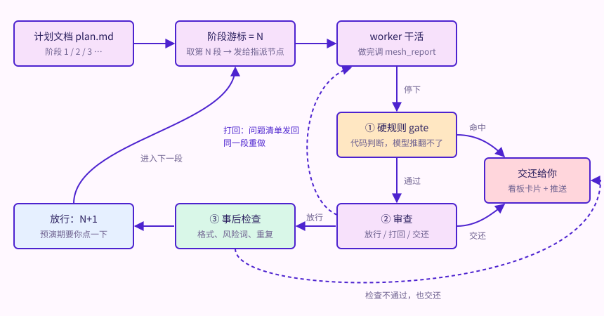

# JINE 对照笔记：哪些值得参考，哪些不必

> 2026-11-23 整理。对象是朋友做的 JINE（`D:\JINE-ame`，内部包名 `xianliao-envelope`，插件 `ame` 0.1.11）。
> 这是给自己看的分析，不是实施清单；每一条都写了“它怎么做”“对我们有什么用”“代价”，取舍由你定。

## 1. JINE 是什么

一个 Electron 悬浮窗，里面是 NGO 的糖糖。本质是**几条不绑定任何项目的 agy 对话**：

- 工作目录是一个空文件夹（`data/agy-cwd`），模式固定 `plan`，人设由 `persona.md` 追加到系统提示词。
- 她只能读：放行的工具只有读文件、`fetch`、`think` 和自带的 `finder`（找文件）。改文件、跑命令都在权限请求那一步被拒。
- 每个 Claude Code 会话里装一个插件（`register.tsx`），把“在做什么、改了哪些文件、在等什么”推给 JINE；JINE 把这些拼进每一轮提示词，她据此聊天、写便签。
- 另有一个后台 agy 进程做杂活：给每个会话写状态卡片、整理记忆、压缩聊天记录。

一句话：**一个只读的旁观者，看着你开着的几个 Claude 会话，给你写便条，便条要你亲手递过去。** 只在一台机器上，只看 Claude。

## 2. 设计思路与局限

| 思路 | 体现 | 评价 |
|---|---|---|
| 角色就是产品 | 便签、撕便签、小本本、贴纸、表情、手机外壳、说话风格的大量约束 | 对“陪伴”定位成立；对“推进项目”来说，形式占比偏大 |
| 人是最后一道门 | 便签默认手动撕；自动推进只预演；重启后一律关闭；拿不准就交还 | 很稳，值得学 |
| 观察而不编排 | 不创建、不分派、不跨机器 | 和我们的需求方向相反 |

**最关键的局限：自动推进的方向来自 Claude 自己。** 审查规则写的是“放行：Claude 想做的下一步就在任务书里”，放行就给同一个会话发“继续做……”。下一步做什么，是 Claude 每轮结尾自己说的（“要不要我接着补测试？”），桌面版还会通过 `wrap_up` 工具交出结构化的“推荐动作”。任务书里虽然有 `plan[]`，但**没有“做到第几步”的游标**，不会主动去取下一步。Claude 写出【任务书完成】，整个流程就停下。

所以它实际解决的是“Claude 老停下来问要不要继续，人要反复回‘好’”这件事，并不负责规划。我们要的是**计划驱动**：方向写在外部的计划文档里，agent 只负责做完当前这一段。

## 3. 值得参考的（按优先级）

### 3.1 自动推进的“外壳”（最有价值）

`autopilot.js` 只有 624 行，因为**判断不在它里面**：读代码、下结论的是模型，这个文件只负责“什么时候审、什么情况不审、怎么问、问完怎么查”。好比求解器的外层迭代控制：最大迭代次数、停滞检测、发散就退出。

**硬规则（`gate`）**：送去审查之前先过一遍，模型推翻不了。

| 情况 | 处理 |
|---|---|
| 你 60 秒内在这个会话打过字 / 在玩游戏 | 暂缓，15 秒后重试，最多等 30 分钟 |
| 本轮报错结束；同一个错误重复出现，或连续两次报错 | 不审，交还 |
| 连续推进 5 轮 / 累计 20 轮 / 开启满 4 小时 | 交还，并关掉自动推进 |
| 连续 3 轮没改任何文件，而且 Claude 说的话两两相似度 ≥ 0.85 | 判定为原地打转，交还 |
| Claude 弹了选择题、说“做完了”、想 commit / 开 PR / merge、提问里出现高风险词 | 照常审，但结论只能是交还 |

**结论只有三种**：
- **放行**：下一步在约定范围内。可以附 1 到 3 条注意事项，只能收紧，不能扩大范围。
- **打回**：必须指出具体文件、哪一步、为什么、怎么改。**说不出具体位置的不许打回**，这条很好地防止了模型泛泛挑刺。
- **交还**：要换方向、有几种做法要选、定稿、改不回来或对外的事、拿不准。

**事后检查（`finalize`）**：模型答完还要再查一遍。没写结论、判了放行却没写要发的话、要发的话里有高风险词、和之前某一轮几乎一样，以上任一情况都改成交还。

**其他**：所有事件写进只追加的日志；你可以对每次审查点好评或差评，留作以后评估；“全停”会作废正在进行的审查。

对我们：直接作为阶段推进器（3.2）的安全层。代价很小，都是纯函数，好写好测。
我们的 `mesh-watchdog.js` 已经有循环检测（先去掉路径和数字再比对错误），这部分比 JINE 好，可以直接复用。

### 3.2 阶段推进器（JINE 没有，是在它基础上的改进）

在 AmeMesh 里加一个“计划文档加阶段游标”：

1. 计划写在 md 里，按约定格式分段，每段写清：标题、指派给哪个节点（机器:目录）、完成标准。
2. 游标指到第 N 段，就把这段包装成任务信封（现有的 `formatEnvelope`：Goal 是段标题，Stop Gate 是完成标准），用现有的 `deliverToNode` 投递（对方忙就进收件箱，空闲再注入）。
3. worker 做完调用 `mesh_report` 汇报，然后依次经过：硬规则 → 审查 → 事后检查。
4. 放行则游标加 1，进入下一段；打回则把问题清单发回原节点，记一次重做；交还则在看板挂卡片并推送通知。
5. 头几周只预演：看板上显示“准备发给 B 的第 3 段”，你点一下才发。

现有零件和缺口：

| 零件 | 现状 |
|---|---|
| 汇报、投递、收件箱、看门狗 | 已有（`mesh.js`、`mesh-watchdog.js`） |
| 每段的目标和停机条件 | 已有，但目前每个节点一份，需要改成每段一份 |
| 计划文档和游标 | 缺。`todos.json` 的计划已经有编号步骤（`todo-steps.js`），可以考虑复用 |
| 结论协议、硬规则、事后检查 | 缺，参考 3.1 |

需要你定的：
- **计划放在哪**：md 文件好写，也能放进 git；todos 的步骤能在网页上编辑打勾，但写不了长内容。
- **谁来审**：master 会话有上下文，但要占一个 agent；服务端直接调一次 API 便宜，也不依赖某个会话的状态。
- **什么时候放开自动发送**：建议按项目单独开关。

### 3.3 会话状态卡片

`secretary.js` 给每个会话维护一张字段固定的卡片：

| 字段 | 含义 |
|---|---|
| goal | 目标 |
| done | 做完了什么 |
| doing | 在做什么 |
| blocker | 卡在哪 |
| next | 下一步 |
| waitingUser | 是否在等你 |
| oneLiner | 一句话概括 |

每次更新只把“旧卡片 + 新增记录”（截到最近 4000 字）交给模型，不重读整段对话，省 token，结果也稳定。扫描对话记录放在 worker 线程里，不卡界面。

对我们：看板目前偏日报和周报（`summary/`），可以给每个会话加一张实时卡片，阶段推进的审查材料也能直接用它。

### 3.4 风险词的否定识别

“别 push”“严格不执行 git 提交”里虽然有 push 和提交，但不算命中。判断方法：在**同一个分句**（以逗号、句号等为界）里，风险词前面出现“不要 / 别 / 禁止 / don't”之类的词，就视为否定。只对“要发给 agent 的话”开启；agent 自己的提问不做这个豁免，出现风险词一律停。

弱点：按子串匹配，“提交表单”也会命中“提交”。宁可多停，不可漏放，可以接受。

### 3.5 打扰节流的参数

同一会话 8 分钟内最多主动提醒一次，全局 3 分钟一次，你 1 分钟内刚说过话就不打扰，检测到在玩游戏时完全静音。看门狗和 Clippy 主动说话时可以参考这组数字。

### 3.6 记忆和检索的小技巧

| 技巧 | 说明 | 代价 |
|---|---|---|
| 写入时打标签 | 每条记忆附 3 到 6 个关键词（同义词、英文名、缩写），相当于写入时就做了语义扩展 | 每次写入多一点 token |
| 检索前折叠 | 中文数字转阿拉伯数字（“第十六天”转“第 16 天”），繁体和日文汉字转简体 | 一个小函数 |
| 按 bm25 排序 | 我在 `search-index` 里没看到排序相关的代码，结果可能是按时间排的 | SQL 加一个 `ORDER BY bm25(...)` |
| 整理只许四种操作 | add / merge / supersede / reclassify，不许删除，锁定条目不动 | 我们的记忆已经有修订和审阅，这条主要是印证 |

语义检索交给 3090 上的 embedding 服务（单独文档），和 FTS5 混合排序。

### 3.7 按路径投票自动归项目

`projects.js` 看会话最近 40 次工具调用里出现的路径，改文件的权重比读文件高，再参考工作目录、标题和第一条指令，投票决定会话属于哪个项目。某个未登记的目录被反复改动，就自动建一个新项目。所有改动写进只追加的 `project-ops.jsonl`，可以回放。

对我们：`project_paths` 已经能给同一个项目登记多个系统的路径，加上投票，跨机器的会话可以自动归到同一个项目。

### 3.8 工程习惯

- **依赖注入**：时钟、定时器、启动子进程的函数都作为参数传进来，测试时换成假的，不用真等时间、真开进程。
- **假后端加界面状态截图**（`fake-agent.js`、`shots.js`）：不连模型也能把界面的每种状态渲染出来检查。
- **注释带日期和原因**：比如“2026-11-22 试用时发现……所以改成……”，过几个月还知道为什么这样写。

## 4. 不建议参考的

| 东西 | 原因 |
|---|---|
| 进程内插件（`register.tsx`，用 `hooks.json` 的 `modules` 字段） | 只适用于 Claude Code，没有公开文档，接口可能变；我们不用桌面版和 IDE，hook 加终端注入已经够用 |
| 陪聊人设和界面包装 | 不是我们的需求；Clippy 已经承担桌面助手的角色 |
| 在桌面端塞一个本地向量模型（129 MB + onnxruntime） | 我们的检索在 NAS 上，改成调用 3090 上的服务 |
| 用 ACP 把 agy 当聊天后端 | 暂时用不上，以后要嵌自己的 agent 时再看 |
| NGO 素材 | 原作版权，说明书也要求不要再传 |

## 5. AmeTyping 已经比它强的

多工具（Claude / Codex / OpenCode / agy / Kiro）、多机器、完整存档和 SHA-256 校验、三层记忆和审阅、跨机拓扑和契约、看门狗、文件摆渡。JINE 的价值在几个局部做法上，整体架构没有参考意义。

## 6. 建议的顺序

1. 检索小改进（3.6 的折叠和 bm25 排序）：改动小，马上能用。
2. 阶段推进器的预演版（3.1 + 3.2）：先只显示“准备发什么”，不自动发。
3. 会话卡片（3.3）：给看板和审查提供材料。
4. 跑稳后，按项目放开自动发送。
