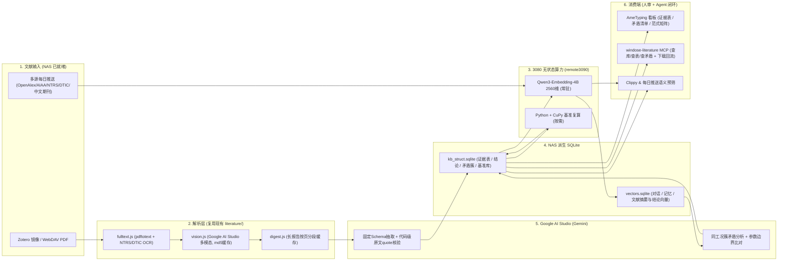

# 全自动科研文献知识库与混合检索架构计划

> 2026-11-24。工作区 `D:\ametyping-embed`，分支 `feature/embed`（已同步 `origin/main` 至 `511aba5`）。
> 本文档固化 AmeTyping 后续“文献向量化 + 全自动结构化科研知识库 + 科研闭环 MCP + 3080 基准复算”的完整架构、历史教训、数据模型、模块边界与分阶段验收标准，供后续按阶段落地时对照执行，避免长对话失真。

---

## 0. 当前基线（已落地与待合状态）

| 模块 | 状态 | 实测 / 备注 |
|---|---|---|
| 向量推理服务（`remote3090`，RTX 3080 10 GB） | **已运行** | `Qwen3-Embedding-4B`（Q8_0，2560 维），`http://192.168.114.3:8090`，常驻显存 ~6.1 GB，开机自启 SYSTEM 任务 |
| 阶段 1：对话混合检索（BM25 + 2560 维 RRF） | **已部署 NAS** | `vectors.sqlite` 281 MB，**21,380 块**（282 万 token，全量 12.7 分钟，增量 <1 秒），端到端查询 184～287 ms，离线自动降级 |
| 阶段 2：记忆条目向量化与语义去重预筛 | **已部署 NAS** | 121 条（47 `memory` + 74 `observed`），记忆召回 28～33 ms；已接入 `vault/review.js` 与 `knowledge-review.js` |
| Clippy 语义召回（记忆 + 跨设备对话片段） | **本地已写完、未提交部署** | 留在 `D:\ametyping-embed`（`feature/embed`）：`research/directories.js`、`research/service.js`、`server.js`，测试全绿 |
| 现有文献解析工作流（`remote/server/literature/`） | **已运行** | Zotero 镜像、WebDAV PDF、多源推送（OpenAlex/AIAA/NTRS/DTIC/中文期刊）、`fulltext.js`、`vision.js`、`digest.js`、`figures.js`、`cards.js`、下载 MCP（`windose-literature`） |

---

## 1. 历史教训复盘（`dell97:~/pj1` LightRAG 系统）

2026-11-24 只读复盘了 `dell97:~/pj1`（当年因单位联网不便搭建的 Zotero → MinerU → LightRAG + 双 4090 vLLM + Open-WebUI 系统），核心实测与教训如下：

| 维度 | `dell97:~/pj1` 实测事实 | 新架构硬性红线 |
|---|---|---|
| **知识表示** | 仅 273 篇论文（6,546 块）被 LightRAG 抽出 **99,672 节点 / 132,526 边**；磁盘 2.7 GB 中 97% 是图谱与缓存（`vdb_chunks.json` 仅 77 MB）；大量噪声实体如 `Equation 26`、`Phi ~ Psi`、`Amplitude`，不得不写 `clean_noise_entities.py` / `merge_person_entities.py` 善后 | **禁止自由实体抽取（Open IE / GraphRAG）**。必须用强约束的固定领域 Schema（10～15 个核心物理字段），且每格强制绑定页码与原文逐字引文 |
| **运维复杂度** | 需要 6 个 tmux session + 2 个 conda 环境 + 2 个 xvfb 虚拟桌面 + 魔改安装包 `prompt.py` + 清理僵尸进程 | **零新常驻框架**。直接长在 NAS 单一 Node 服务 + SQLite 上；3080 只做无状态计算节点 |
| **存储与写入** | 全量 JSON / GraphML 每次写盘重写数百 MB～1.1 GB，单篇入库耗时十多分钟 | 全部用 **SQLite（WAL 模式）+ SHA-256 去重 + 增量更新**，派生库随时可删可重建 |
| **跨语言检索** | `bge-m3` 中文直接搜英文论文掉点明显（曾写 `rag_test2.py` 做双语扩展补救） | 已升级至 2560 维 `Qwen3-Embedding-4B`，实测中英跨语言直出 Top-1 |
| **使用体验** | Open-WebUI 聊天式 RAG 脱离日常工作流，无法跨论文拉通对比定量参数、看不到页码出处 | 直接嵌入 AmeTyping 看板「文献」窗口（可筛选表格、点单元格跳 PDF 对应页）+ 暴露 MCP 给日常 coding agent |

> **可复用现成资产**：`dell97:~/pj1/lightrag_docs/` 中已有 **273 篇 MinerU 转好的带 LaTeX 公式 `paper.md`**（含 YAML frontmatter），试点对照时可直接参考，无需重跑。

---

## 2. 总体架构与三端分工

不再依赖独立 4090 服务器，也不在 3080 上折腾本地 MinerU 或本地大模型。三端各做最擅长的事：

- **NAS 中心（AmeTyping Node 服务）**：Zotero 镜像、PDF 与 NTRS/DTIC OCR 文本缓存、`vision.js` 缓存、`vectors.sqlite`、`kb_struct.sqlite`、增量调度、看板 UI、MCP Hub。
- **3080 节点（`remote3090`，RTX 3080 10 GB，无状态）**：
  1. 常驻 **Qwen3-Embedding-4B（2560 维）**（~6.1 GB 显存）——服务对话/记忆/文献检索，以及**跨论文结论聚类**；
  2. 按需跑 **第四层 Python + CuPy 经典基准复算**（1D/经典 2D 算例，3080 绰绰有余）。
- **云端 API（Google AI Studio / Gemini）**：
  1. 复用现有 `vision.js`，将公式密集页、跨栏表格页、无文字层老扫描件转成带 LaTeX 的 Markdown（按 PDF `md5` 永久缓存，直接替代本地 MinerU）；
  2. 按固定领域 Schema 批量抽取结构化证据表；
  3. 对向量聚类后的同工况结论簇做跨论文矛盾分析与参数边界比对。



---

## 3. 核心模块设计（M1～M6）

### M1：文献向量与语义路由层（原阶段 3）
- **存储**：复用 `data/vectors.sqlite`，新增 `lit_vec(kind, key, sha256, dims, vec, updated)`：
  - `kind = 'item'`：Zotero 标题 + 摘要 + 标签（约 457 条）；
  - `kind = 'note'`：用户笔记与批注（约 364 条）；
  - `kind = 'claim'`：M3 抽出的每条论文“条件 → 结论”（供 M4 聚类）。
- **接入点**：
  - `literature/feed.js`：每日推送候选先与 `profile.js` 中研究主线及开放问题的向量做相似度预筛，减少关键词漏筛与无效大模型打分；
  - 文献库支持中英跨语言语义搜索与“相似论文”推荐。

### M2：解析层复用（零重复造轮子）
- 统一入口为 `fulltext.forItem(key)`，直接获得带真实页码的逐页文本数组。
- **分级策略**：
  1. 现代 PDF 优先用 `pdftotext`；扫描版老 NASA/DTIC 报告自动走 `fulltext.js` 已内置的 NTRS/DTIC OCR 文本；
  2. 仅当 `scanned === true` 且无现成 OCR，或关键参数/公式页抽字乱码时，走现有 `vision.js` 调 Google AI Studio 转 LaTeX Markdown（按 `md5` 缓存，永不重复付费）；
  3. 超过 25 万字的长报告自动复用 `digest.js`（按页边界分段、前后各带 1 页上下文、按段哈希缓存）。

### M3：结构化证据表引擎（第一层，`remote/server/literature/evidence.js`）
独立派生库 `data/literature/kb_struct.sqlite`（不放进 `knowledge.sqlite`，随时可删可重建）：

```sql
-- 1. 论文结构化证据表（每篇 × Schema 版本一条）
CREATE TABLE IF NOT EXISTS paper_evidence (
  zotero_key TEXT NOT NULL,
  schema_id TEXT NOT NULL,          -- 如 'plasma_rcs_v1' / 'aero_stealth_v1'
  pdf_md5 TEXT NOT NULL,
  fields_json TEXT NOT NULL,        -- { field: { value, unit, page, quote, verified } }
  verified_ratio REAL NOT NULL,     -- 通过原文逐字校验的字段占比
  human_verified INTEGER DEFAULT 0, -- 用户在看板确认/修订后置 1，优先作后续校准样本
  model TEXT NOT NULL,
  updated INTEGER NOT NULL,
  PRIMARY KEY (zotero_key, schema_id)
);

-- 2. 论文原子结论表（“在什么条件下得到什么结论”）
CREATE TABLE IF NOT EXISTS paper_claims (
  id TEXT PRIMARY KEY,
  zotero_key TEXT NOT NULL,
  schema_id TEXT NOT NULL,
  condition TEXT NOT NULL,          -- 工况/无量纲参数/假设条件
  conclusion TEXT NOT NULL,         -- 定量或定性结论
  metric TEXT DEFAULT '',           -- 关键数值与单位
  page INTEGER NOT NULL,
  quote TEXT NOT NULL,              -- 原文逐字引文
  verified INTEGER NOT NULL,        -- 1=原文核验通过，0=未通过（不参与自动聚合）
  updated INTEGER NOT NULL
);

-- 3. 同工况结论簇与矛盾清单（第二层）
CREATE TABLE IF NOT EXISTS claim_contradictions (
  id TEXT PRIMARY KEY,
  schema_id TEXT NOT NULL,
  topic TEXT NOT NULL,              -- 簇主题（如“71 km RAM-C II 峰值电子密度”）
  claim_ids_json TEXT NOT NULL,     -- 涉及的 paper_claims.id 列表
  verdict TEXT NOT NULL,            -- 'consistent' | 'contradiction' | 'boundary_diff'
  summary TEXT NOT NULL,            -- 矛盾点与参数边界差异说明
  param_diff_json TEXT NOT NULL,    -- 双方关键参数对照表
  status TEXT DEFAULT 'pending',    -- 'pending' | 'confirmed' | 'dismissed'
  updated INTEGER NOT NULL
);

-- 4. 3080 经典基准复算库（第四层）
CREATE TABLE IF NOT EXISTS benchmarks (
  id TEXT PRIMARY KEY,
  title TEXT NOT NULL,
  zotero_keys_json TEXT NOT NULL,   -- 对应参考论文
  script_path TEXT NOT NULL,        -- 复算脚本路径（Python + CuPy）
  npz_path TEXT NOT NULL,           -- 全量算力产物路径（强制 .npz）
  status TEXT NOT NULL,             -- 'reproduced' | 'mismatch' | 'failed'
  error_summary TEXT NOT NULL,      -- 与论文数值/曲线的误差总结
  updated INTEGER NOT NULL
);
```

- **防幻觉硬闸门（Verifier）**：
  - 复用 `research/extract.js` 的逐字引文校验逻辑：模型输出 JSON 后，代码自动去 `fulltext` 的 `page`（及 `page±1`）做规范化子串/模糊匹配；
  - 原文找不到的字段自动重试一次，仍找不到则标 `verified = 0` 隔离；
  - **严格区分事实与推断**：只有 `verified = 1` 的条目才进入矛盾聚类与范式矩阵统计，杜绝错误滚雪球。

### M4：向量聚类 + 矛盾发现 + 范式矩阵（第二、三层，`remote/server/literature/paradigm.js`）
- **向量当聚类胶水**：将所有 `verified = 1` 的 `paper_claims` 送 3080 算 2560 维向量，在 NAS 内存中按余弦相似度聚类为若干同物理量/同工况簇（将 $O(N^2)$ 两两比对压缩为几十次大模型调用）。
- **矛盾与边界判定**：每个簇发 1 次 Google AI Studio 请求，严格要求输出“结论一致 / 存在矛盾 / 参数边界差异”，并列明双方无量纲参数或模型假设的差异，附论文键与页码。
- **范式矩阵（第三层）**：直接用 SQL 对 `paper_evidence` 做交叉统计（如 `化学模型 × 电磁算法 × 频段 × 验证基准`），零模型成本生成密集区与空白区。

### M5：看板 UI 与人在回路审稿（让你“用得舒服”）
直接在现有 AmeTyping「文献」窗口增加 3 个标签页：
1. **证据表**：支持按方法、频段、验证基准筛选；**点击任意单元格直接跳到右侧 PDF 对应页并高亮 `quote`**；支持行内修订（修订后置 `human_verified = 1`，自动成为后续抽取的校准样本）。
2. **矛盾与边界**：展示待审阅的跨论文矛盾对与参数对比，每周花 ~20 分钟点击“确认有价值 / 误报忽略”。
3. **范式矩阵**：二维矩阵展示已有研究分布与空白格，点击格子直接列出对应论文。

### M6：3080 经典基准复算闭环（第四层，按需延后）
- 通过现有 `remote3090` 无头 agent / AmeMesh，挑经典可复算算例（1D 分层等离子体传输矩阵、1D Drude ADE-FDTD、驻点线估算、经典 2D 散射/Mie 球）。
- AI 生成标准化 Python + CuPy 脚本下发到 3080 运行，全量结果按规范存为 `.npz`，自动比对论文数值并回写 `benchmarks` 表；复算失败的论文单独标注。

---

## 4. 科研闭环 MCP 设计与“新老结合”方法论

### 4.1 扩展 `windose-literature` MCP（只读查询 + 已有下载闭环）
在现有下载工具（`submit_downloads` / `download_status` / `save_pdf`）旁新增 4 个只读工具，让 Claude Code / Codex / OpenCode / Antigravity 在写代码、做仿真、写论文时直接调用：

| 工具名 | 作用 |
|---|---|
| `search_library(query, k)` | 跨语言语义 + 关键词检索本地 Zotero 摘要、笔记、批注与卡片 |
| `query_evidence(schema_id, filters)` | 按物理字段筛选结构化证据表，返回带页码与原文引文的定量数据 |
| `get_contradictions_and_gaps(schema_id, topic)` | 返回已核验的跨论文矛盾清单与范式矩阵分布 |
| `read_paper_pages(key, pages)` | 按页号读取 `fulltext/vision` 原文，用于精确核对公式与参数 |

### 4.2 防止 agent 因调用本地 MCP 而偷懒不上网查文献
本地库（~457 篇）定位是**“已核验的个人精读家底（Ground Truth）”**，外部检索（OpenAlex / arXiv / NTRS / Web Search）是**“外部增量雷达”**。工程上加两道硬约束：
1. **覆盖度自报**：每个本地 MCP 工具的返回值固定携带 `coverage: { matched, library_total, newest_year, scope_warning }`，明确提醒仅覆盖本地库，立项/查新/新点子论证必须结合外部检索；
2. **三步调研协议（写入 MCP 工具说明）**：**① 先查家底**（调本地 MCP 摸清已有基准、矛盾与术语）→ **② 必查外部**（用外部检索补近 2～3 年新进展与本地空白区）→ **③ 下载回流**（遇到高价值缺失文献直接调 `submit_downloads` 入库，入库后自动进解析与证据表）。

### 4.3 新点子开发的“三锚点”推进法（新老结合，不拘泥、不冒进）
1. **用“老”锚定底线（防冒进）**：
   - *物理边界锚*：新想法先过证据表与矛盾清单，核清它在哪个无量纲区间（$ka$、$n_e/n_c$、碰撞频率等）成立、前人失败边界在哪；
   - *工程能力锚*：结合 `windose-research` 对照现有求解器家底（CuPy MoM / CEM_PO / 网格管线），明确改造成本。
2. **用“新”撕开缺口（防拘泥）**：
   - 不做纯“矩阵填格子”式水组合；优先从两处找硬核突破口：① **矛盾清单里解释不清的过渡区**（现有简化假设失效之处）；② **外部新文献的跨界方法**嫁接到证据表标出的核心精度/算力短板上。
3. **用“最小基准复算”裁决（有理有据）**：
   - 先在 3080 上用经典 1D/2D 基准算例跑最小可证伪实验并全量存 `.npz`；跑赢老基准再向三维复杂外形推进，跑不赢当场记录失效边界并低成本止损。

---

## 5. 落地里程碑与验收标准

| 里程碑 | 范围 | 验收标准 |
|---|---|---|
| **M0：向量与召回收尾** | 提交部署本地已写好的 Clippy 语义召回；实现 **M1**（Zotero 摘要/笔记/批注向量化 + `feed.js` 每日推送语义预筛） | 10 篇已知相关论文跨语言搜进 Top-10；每日推送走语义预筛且离线自动降级 |
| **M1：30～50 篇证据表试点** | 实现 `kb_struct.sqlite` + **M3** 抽取器（Google AI Studio）+ 代码级原文 `quote` 核验；选 1 个细分方向跑 30～50 篇 | 导出证据表人工抽查 10 条：**字段准确率 ≥85%，无出处幻觉 = 0%**（过关才进入 M2） |
| **M2：全自动知识库可用** | 实现 **M4**（向量聚类抓矛盾 + SQL 范式矩阵）+ **M5**（看板 3 个 Tab + 人工修订校准）+ 每日新论文自动增量抽取 + 扩展 `windose-literature` MCP | 全库自动运转；每周人工审阅 ≤20 分钟；Agent 可通过 MCP 查表并联动外部查新 |
| **M3：基准复算与深度联动** | 实现 **M6**（3080 CuPy 基准复算闭环 + `.npz` 归档）；将结构化证据表接入 Clippy 问答 | 至少跑通 2～3 个经典基准算例并回写对照误差；Clippy 可直接回答跨论文定量对比 |

---

## 6. 开工前待拍板事项（等用户指示）

1. **M0 启动时机**：是否将本地待提交的 Clippy 语义召回与 M1 一起完成并合入 `main` 部署。
2. **M1 试点子方向与首版 Schema**：先选哪个方向（如“等离子体鞘套与电磁衰减/RCS”或“气动隐身优化与高频散射”），以及最关心的 10～15 个固定物理字段。
3. **Google AI Studio 凭证接入**：复用现有 `remote/server/ai/google-ai-api.js` 即可，动工时确认所选模型（如 Gemini 2.5 Flash / Pro）及速率限制。

---

## 7. 相关文件索引

| 文件 | 作用 |
|---|---|
| `docs/embedding-plan.md` | 向量检索基建现状、数据量实测与分阶段总计划 |
| `docs/embedding-service.md` | `remote3090` 向量服务接口、实测与运维说明 |
| `remote/server/embed/` | 已落地的 NAS 侧向量客户端、清洗切块、存储、增量任务与混合检索 |
| `remote/server/literature/fulltext.js`、`vision.js`、`digest.js`、`figures.js` | 现有 PDF 解析、多模态读公式、长报告分段与裁图基建 |
| `remote/server/literature/feed.js`、`profile.js` | 每日文献推送与研究画像（M1 接入点） |
| `remote/server/literature/mcp.js` | 现有下载 MCP（M2 扩展只读查询工具的接入点） |
| `remote/server/research/extract.js` | 现有原文逐字引文校验参考实现 |
| `remote/server/ai/google-ai-api.js` | 现有 Google AI Studio 调用封装 |
