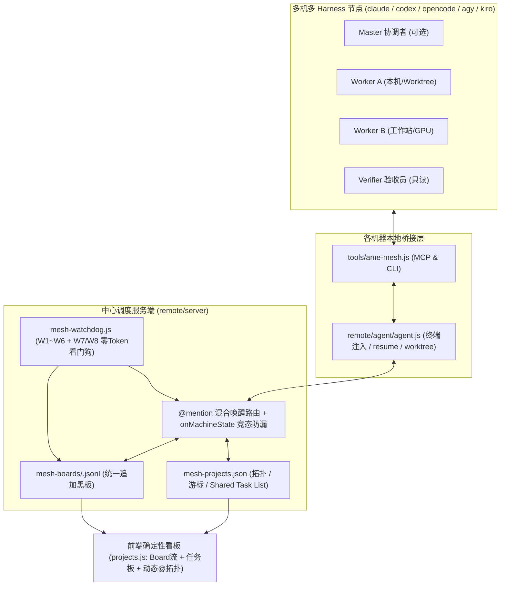
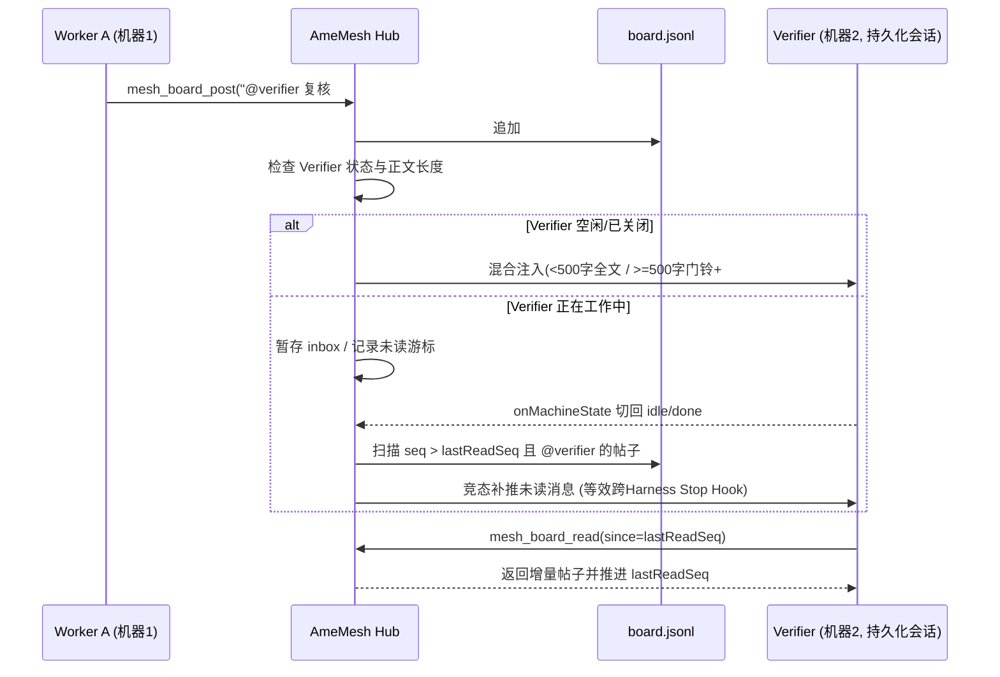

# AmeMesh → 跨机器跨 Harness Swarm 改造设计计划

> **状态**：设计定稿（待实施）  
> **目标分支**：基于 `D:\ametyping-agy` 现有 AmeMesh 架构增量升级  
> **核心定位**：复用 AmeMesh 已打通的跨机器 WebSocket 通道、5 种 Harness（`claude / codex / opencode / agy / kiro`）唤醒链路与确定性看门狗，融合 **AGY `/swarm` 共享黑板**、**Claude Code Agent Teams 共享任务依赖表** 与 **Cursor/Codex Worktree 隔离**，升级为**跨机器、跨 Harness、零常驻解说 LLM** 的协同蜂群系统。

---

## 1. 背景与业界横向对比

目前 AmeMesh 已具备跨机派生（`mesh_spawn`）、空闲直注/离线自动续聊（`deliverToNode`）、忙时收件箱（`inbox`）、确定性看门狗（`W1~W6`）、长计算脱离运行（`mesh_run`）和目录触发器（`mesh_trigger`）。主要短板在于通信仍停留在**点对点私信 + Master 传话筒**模式，缺少统一可回溯的共享黑板、结构化任务依赖和动态交互拓扑。

| 方案 | 通信与协调机制 | 核心亮点 | 局限性 |
| :--- | :--- | :--- | :--- |
| **Google Antigravity `/swarm`** | 共享追加黑板 `board.jsonl` + `@mention` 门铃 + `#seq` 指针 | 防上下文膨胀；Stop Hook 竞态锁防漏消息；砍掉常驻 LLM `narrator` 改用确定性前端看板 | 仅限单机、仅限 `agy` |
| **Claude Code Agent Teams** | 共享任务板（Shared Task List）+ 本地邮箱（Mailbox JSON） | 任务支持文件锁与依赖自动解锁（`blockedBy`）；Teammate 点对点对抗质询 | 仅限单机、仅限 Claude Code |
| **Cursor / OpenAI Codex** | Git Worktree 隔离 + 无头后台执行 + 统一 Diff 审阅 | 同仓库多 Agent 并行写代码不互相覆盖 | 偏独立分支各自收尾，成员实时协同弱 |
| **LangGraph / A2A + MCP** | Hybrid Graph-Blackboard（确定性流程 + 共享事实源） | MCP 统一工具/黑板接入，A2A 规范跨框架长任务生命周期 | 偏向云端 API，对本地终端 CLI 接入重 |
| **AmeMesh（改造后）** | **统一共享黑板 + 共享任务依赖表 + 跨机/跨 Harness 唤醒** | 兼具跨机跨 5 种 CLI、零 Token 看门狗、科研长计算脱离运行与动态交互拓扑 | — |

---

## 2. 核心设计原则与已对齐决策

1. **一切通信皆黑板（单一事实源）**：不再区分“私信”与“黑板”。`@单个节点` 即等价于定向点名唤醒，同时记录公开留痕在黑板上供验收员与人类按 `#seq` 溯源。原有 `mesh_send` / `mesh_report` 保留兼容，底层统一写入黑板。
2. **会话持久化 + 混合阈值唤醒**：每个节点始终是**同一个持久化会话**（空闲时 0 Token 休眠，唤醒即向原会话注入/续聊，而非开新对话）。被 `@` 唤醒时采用混合模式：
   - 正文 `< 500` 字：随唤醒提示直接注入全文，省一次 `mesh_board_read` 工具调用；
   - 正文 `>= 500` 字：只注入极简门铃（`#seq` + 发送方 + 前 120 字摘要），引导节点按需调用 `mesh_board_read`。
3. **保留中枢 + 底层平级通信**：
   - 保留 `master` 作为默认中枢（唯一人类接口、任务拆解、冲突裁决、清场收官）；
   - 底层黑板通信完全平级：任何节点都可以直接 `@` 其他节点（如 `verifier` 直接打回 `worker`），无需 `master` 传话。
4. **“选组”与“选模型/回落”解耦**：
   - **Master 只负责按任务性质选“模型能力组（Model Pool）”**（不操心具体额度与限流）；
   - **确定性路由与回落程序（0 Token）**负责探测各 Harness/模型可用性与额度、组内自动顺延切换、全组耗尽时才上报 Master 与用户。
5. **确定性优先，绝不养常驻 LLM 当解说员**：看门狗、任务依赖解锁、模型额度熔断回落、前端 Board/Task/动态拓扑图全部由确定性代码计算，零额外推理消耗。
6. **大文件摆渡降权收纳**：局域网环境为主，保留底层 `mesh_transfer` 代码不删，在前端 UI 中从一级 Tab 收纳至次要入口/折叠工具区。

---

## 3. 系统架构与核心机制

### 3.1 总体架构图



### 3.2 混合唤醒与竞态防漏时序



---

## 4. 详细模块设计

### 4.1 统一共享黑板（`remote/server/mesh-board.js` + `mesh.js`）

* **落盘路径**：`<dataDir>/mesh-boards/<projectId>.jsonl`（每个项目独立文件，只追加写入，避免 `mesh-projects.json` 膨胀）。
* **单行记录结构**：
  ```json
  {
    "seq": 12,
    "ts": 1795337324000,
    "channel": "main",
    "kind": "post",
    "agent": "verifier",
    "nodeId": "node_a1b2c3",
    "text": "@fixer-code 复核 #5 与 #6 时发现中英混排误判，请修复。",
    "mentions": ["fixer-code"],
    "mentionAll": false,
    "mentionChannels": [],
    "refs": [5, 6],
    "artifacts": [],
    "done": false
  }
  ```
* **`kind` 枚举**：
  * `brief`：`mesh_spawn` 自动写入的开局派活契约（公开账本）；
  * `post`：成员通过 `mesh_board_post` 或兼容 `mesh_send` 发布的帖子；
  * `report`：成员通过兼容 `mesh_report` 提交的阶段汇报；
  * `task`：共享任务板状态变更/依赖解锁的系统通知；
  * `event`：`mesh_run` 后台作业结束、文件夹触发器事件；
  * `watchdog`：看门狗告警与催醒记录；
  * `control`：Phase 3 多频道创建/订阅/归档控制帧（事件溯源）。
* **节点新增游标字段（位于 `mesh-projects.json` 的 `node` 对象）**：
  * `lastReadSeq`: 该节点最后一次实际读取到的楼层号（默认新 spawn 节点跳过历史开局噪音，从自身 `brief` 所在楼层开始）；
  * `lastPostSeq`: 该节点最后一次发帖的楼层号（供看门狗 `W7` 精准判死锁）；
  * `lastMentionedSeq`: 最近一次被 `@` 的楼层号及时间戳 `lastMentionedAt`；
  * `wakeMode`: `'mentions'`（默认，仅点名唤醒）| `'all'`（频道全唤醒）；
  * `workspaceMode`: `'inherit'`（默认）| `'worktree'`，以及 `worktreeBranch`、`worktreeParentRepo`。
* **跨 Harness 防漏消息闸机**：
  * 在 `mesh.js` 的 `onMachineState()` 中，每当某节点状态由 `working/thinking/reading` 变为 `idle/done` 且无权限弹窗时，除了刷新现有 `inbox`，额外核对：`node.lastMentionedSeq > node.lastReadSeq`。
  * 若存在未读 `@mention`，自动汇总未读楼层（按混合阈值规则）补推给该节点并记录 `lastNudgedSeq`，防止“刚准备休眠、新帖落地”导致的漏接。

### 4.2 共享任务板（Shared Task List）

* **存储结构（位于 `proj.tasks[]`）**：
  ```json
  {
    "id": "task_1",
    "title": "修复导出脚本字形映射",
    "desc": "确保中文与特殊符号可复制无乱码",
    "ownerNodeId": "node_xxx",
    "status": "pending",
    "blockedBy": ["task_0"],
    "boardRefs": [5, 6],
    "artifacts": [],
    "createdAt": 1795337000000,
    "updatedAt": 1795337324000
  }
  ```
* **状态流转**：`pending` → `in_progress` → `review` → `done`（或 `blocked`）。
* **确定性依赖解锁**：
  * 当任意任务更新为 `done` 时，服务端扫描所有 `blockedBy` 包含该任务 ID 且状态为 `pending` 的下游任务；
  * 若其全部前置任务均为 `done`，服务端自动往黑板追加一条 `kind: "task"` 帖子，内容为 `@<下游owner> 前置任务 [task_0] 已完成（见 #12），任务 [task_1] 已自动解锁，可开始执行`，并触发混合唤醒。

### 4.3 外置角色库、Google 规范精修与 Master 自动调度

* **外置热加载存储**：
  * 仓库内置默认角色模板目录 `remote/server/mesh-roles/*.md`，用户数据目录 `<dataDir>/mesh-roles/*.md` 支持覆盖或新增任意角色（热加载，无需重启）。
  * 每个角色文件包含头部元信息（角色名、一句话适用场景、默认绑定模型组 `defaultPool`、默认工作区模式 `inherit | worktree`、是否只读）与正文行为规范。
* **参照 Google 原生 Swarm 规范精修**：
  * `master.md`：*Do not do the work*（不陷入编码/长排查，保持短回合随时响应用户）、按无碰撞边界切块、每 2~4 个作者配 1 个 `verifier`、派活书自包含、禁用复制粘贴转述（统一用 `#seq`）、`@` 只当门铃不当抄送、清理 worktree 前先合并。
  * `worker.md`：严格遵守目录与 Stop Gate 边界、最终交卷带 `[done]`、同伴接力直接 `@` 下一棒，仅完工/阻塞/需拍板时 `@master`。
  * `verifier.md`：**硬约束只查不改业务代码**，拿真实样本与测试复核 `#seq`，有问题直接 `@author` 贴复现命令与报错行号打回，通过后 `@master [done]`。
  * `peer.md`：平级联调协作者；同时支持用户随时新增科研专属角色（如 `solver-runner`、`plot-analyst`）。
* **Master 读名片自动调度（无需人工介入）**：
  * 服务端自动聚合所有可用角色的精简“角色名片目录（Role Catalog）”（每角色 1~2 行：名称 + 适用场景 + 默认模型组），注入 Master 首轮契约或经 `mesh_status` 返回；
  * Master 只需调用 `mesh_spawn(role="verifier", pool="flagship", ...)`，服务端自动装配对应 `.md` 规范并交给路由引擎选定具体模型与 Harness。

### 4.4 模型分组池（Model Pool）与确定性自动回落引擎

新增 `remote/server/mesh-model-router.js`，将**“选档位（Master 做）”**与**“探活 + 额度监控 + 故障回落（纯代码做）”**彻底解耦：

* **可配置的模型分组（示例，全部在 Win98 页面可视化增改）**：
  * `fast-coder`（日常编码 / 调度组）：如 `claude:sonnet` → `agy:hydrogen` → `opencode:sol`
  * `flagship`（主力推理 / 攻坚组）：如 `claude:opus` → `agy:neon` → `agy:argon` → `opencode:astra`
  * `heavy-reasoner`（超重规划 / 深度排障组）：如 `agy:carbon` → `devin:fable-5.2`
  * `image-gen`（生图 / 多模态组）：如 `codex/gpt` 生图通道
  * 每个模型条目可附带简短 `quirks`（个性微调提示词，如“偏向直接给结论，需提醒贴原始测试输出”），注入时自动拼接。
* **双通道健康与额度探测**：
  * **主动探活**：复用/扩展各机器的 `quota-notices.js`、`claude-profiles.js` 以及 CLI 查余额命令（如 `agy models` / 网关额度查询），定期刷新各候选状态（`healthy` / `low_quota` / `cooldown` / `offline`）；
  * **被动熔断**：一旦任何节点启动失败或运行中捕获 `429 / RESOURCE_EXHAUSTED / Out of credits / quota` 错误，立即将该候选置为 `cooldown`（记录预计重置时间 `resetAt`），不再重复盲试。
* **三级回落策略（全自动，全组挂了才上报）**：
  1. **启动期回落**：`mesh_spawn` 按 `pool` 优先级依次尝试健康候选，前一个调不起来自动顺延同组下一个；
  2. **运行期同 Harness 热切**：支持热切模型的 Harness（如 `agy` / `opencode`）优先原地切同组下一候选，保留原会话记忆；
  3. **运行期跨 Harness 黑板接力**：若需跨 CLI 回落（例如 Claude Code 额度耗尽切到同组的 `agy` 或 `codex`），由于完整事实都在 `board.jsonl` + `tasks[]` + 同一工作区/worktree 中，调度器自动拉起同组下一个健康 Harness 接管该节点任务，首轮注入未完成 `taskId` 与相关 `#seq` 索引无缝续跑；
  4. **全组耗尽上报**：当某组所有候选均不可用时，往黑板追加 `watchdog` 告警并推送通知给 `master` 与用户，由用户决定降级到其他组或暂停等待。

### 4.5 MCP 工具接口（`tools/ame-mesh.js`）

| 工具名 | 状态 | 用途与关键参数 |
| :--- | :---: | :--- |
| `mesh_board_post` | **新增** | 发帖到黑板并按 `@alias` / `@all` 触发混合唤醒。参数：`text`, `channel?`, `artifacts?`, `done?` |
| `mesh_board_read` | **新增** | 按楼层拉取黑板增量帖子并更新 `lastReadSeq`。参数：`since?`, `limit?`, `channel?`, `seqList?`（支持按 `#5,#6` 精准读指定楼层） |
| `mesh_task` | **新增** | 管理共享任务板。参数：`action` (`list`/`add`/`claim`/`update`), `taskId?`, `title?`, `ownerNodeId?`, `status?`, `blockedBy?`, `boardRefs?` |
| `mesh_spawn` | **扩展** | 支持任意已注册 `role`；支持传 `pool`（模型组名，由路由引擎选具体 `tool/model` 并自动回落，也保留显式指定 `tool/model` 覆盖）；新增可选 `workspaceMode: 'inherit' \| 'worktree'`、`branch?`；自动将派活契约记为黑板 `brief` 帖 |
| `mesh_send` | **兼容转写** | 保留原签名，底层自动转为 `mesh_board_post("@<toAlias> <text>")` |
| `mesh_report` | **兼容转写** | 保留原签名，底层自动转为 `mesh_board_post("@<masterAlias> [done/blocked] <summary>", kind="report")`，同步更新节点 `reviewStatus` |

### 4.6 看门狗升级（`remote/server/mesh-watchdog.js`）

保留现有 `W1~W6`，新增两条 Swarm 专属确定性规则：
* **`W7_UNANSWERED_MENTION`（点名未回帖）**：节点 `lastMentionedSeq > lastPostSeq` 且距 `lastMentionedAt` 超过阈值（默认 10 分钟），同时节点已处于 `idle` 或无进展。精准识别“被唤醒但模型静默失败/额度耗尽”，若命中额度耗尽则直接联动 `mesh-model-router` 触发组内回落，否则最多催醒 2 次后升级通知 `master` 与用户。
* **`W8_SWARM_STALL`（全组停滞）**：项目存在未完成 `tasks`（非 `done`），但所有非 `master` 节点均处于 `idle/waiting` 超过阈值（默认 5 分钟），自动往黑板发一条 `watchdog` 帖并 `@master` 介入推动或收官。

### 4.7 同仓并发 Worktree 隔离（`remote/agent/agent.js` + `mesh.js`）

* 当 `mesh_spawn` 指定 `workspaceMode: "worktree"` 时：
  1. 目标机器的 `remote/agent` 检查 `cwd` 是否为 Git 仓库；
  2. 在同级目录或 `.ame-worktrees/<alias>-<shortId>` 执行 `git worktree add -b mesh/<alias>-<shortId>`；
  3. 以新生成的 worktree 路径作为实际 `cwd` 启动对应 CLI（`claude/codex/opencode/agy/kiro`）；
  4. 节点卡片显示其所属分支名；移除节点前若该分支有未合并提交，前端弹出合并提醒，避免丢失改动。

### 4.8 前端确定性看板与 Win98 管理页面（`remote/public/js/apps/projects.js`）

* **Tab 布局调整**：
  1. `研究与计算`（保留）
  2. **`黑板与任务 (Board & Tasks)`（新增主视角）**：
     - 顶部紧凑 **任务板进度条**（显示 `pending / in_progress / review / done / blocked` 与 `blockedBy` 依赖胶囊）；
     - 主区 **Board 帖子流**：高亮 `@mention`，将正文中的 `#5`、`#6` 渲染为可点击跳转并闪烁高亮对应楼层的胶囊；支持按成员、类型（帖子/契约/任务/看门狗/计算事件）和关键词筛选；支持直接在页面底部以“人类管理员”身份发帖 `@某节点`。
  3. **`协同拓扑与动态图 (Topology & Graph)`（升级原拓扑 Tab）**：
     - 保留静态分层卡片（主控 / 平级 / 执行 / 验收）；
     - 新增 **动态 `@` 交互拓扑图（SVG）**：节点状态灯实时同步，有向边粗细对应黑板实际 `@` 频次，附带**时间轴滑块**按楼层 `#1..#N` 回放协作与打回返工过程。
  4. **`角色与模型池 (Roles & Pools)`（新增 Win98 可视化控制页）**：
     - **角色管理区**：可视化增/删/改 `.md` 角色模板（编辑角色名、适用场景、默认绑定模型组、工作区模式、行为提示词正文），支持一键恢复默认（参照 Google 规范精修版）；
     - **模型池与回落监控区**：可视化配置各能力组（如 `fast-coder` / `flagship` / `heavy-reasoner` / `image-gen`）及其内部 `(harness, model, quirks)` 拖拽排序优先级；实时展示每个候选的健康灯、剩余额度/冷却倒计时、手动复位熔断按钮。
  5. `跨机目录与结构树`（保留）
  6. `⚡ 触发器与看门狗`（保留，新增 `W7/W8` 配置项）
  7. **大文件摆渡降权**：将原一级 Tab「文件协同与硬盘摆渡」收纳到项目头部右侧的次要按钮/折叠抽屉（有待处理传输时才亮角标），不占主导航空间。

---

## 5. 分阶段实施路线与验证清单

### Phase 1：统一黑板 + 共享任务板 + 混合唤醒（核心闭环）
* **涉及文件**：
  * 新增 `remote/server/mesh-board.js`（JSONL 读写、`@mention` 与 `#seq` 解析、混合阈值拼装）
  * 修改 `remote/server/mesh.js`（集成黑板、`tasks[]` 依赖自动解锁、`mesh_send/report` 兼容转写、`onMachineState` 竞态补推、新增 HTTP 接口 `/api/mesh/board/*` 与 `/api/mesh/task`）
  * 修改 `tools/ame-mesh.js`（新增 `mesh_board_post`、`mesh_board_read`、`mesh_task` 及 CLI 子命令）
  * 修改 `remote/public/js/mesh.js`、`remote/public/js/apps/projects.js`（新增 Board 帖子流 + 任务进度条 + 大文件摆渡降权收纳）
* **验收标准**：
  * 单元测试覆盖黑板追加、楼层引用解析、混合阈值分流（`<500` vs `>=500`）、`blockedBy` 自动解锁、`onMachineState` 竞态补推；
  * 实测跨两台机器（或本机两个不同 Harness，如 `agy` + `claude`）完成一次 `worker -> verifier -> worker -> master` 黑板接力闭环。

### Phase 2：外置角色库 + 模型池自动回落 + 看门狗 `W7/W8` + 动态 `@` 拓扑图
* **涉及文件**：
  * 新增 `remote/server/mesh-roles/*.md`（参照 Google 规范精修的 `master / worker / verifier / peer` 默认模板）与热加载器
  * 新增 `remote/server/mesh-model-router.js`（Model Pool 分组配置、主动探活/被动熔断、启动期顺延 + 同 Harness 热切 + 跨 Harness 黑板接力 + 全组耗尽上报）
  * 修改 `remote/server/mesh.js`（Role Catalog 注入、`mesh_spawn` 支持 `pool` 与自定义 `role`、新增 `/api/mesh/roles` 与 `/api/mesh/pools` 接口）
  * 修改 `remote/server/mesh-watchdog.js`（新增 `W7_UNANSWERED_MENTION` 联动回落、`W8_SWARM_STALL`）
  * 修改 `remote/public/js/apps/projects.js`（新增 Win98 **「角色与模型池」**可视化管理页 + SVG 动态加权拓扑图与 `#1..#N` 时间轴回放）
  * 补齐 `remote/test/mesh-watchdog.test.js`、`remote/test/mesh.test.js`、`remote/test/mesh-model-router.test.js`
* **验收标准**：
  * Win98 页面可增删改角色模板、拖拽调整模型组优先级并实时查看各模型健康/冷却状态；
  * 模拟同组首选模型报 429 / 额度耗尽，调度器自动熔断并顺延同组下一模型（含跨 Harness 借黑板接力），全组耗尽时准确上报 Master 与用户；
  * 模拟节点被 `@` 后静默不回帖，`W7` 准确告警；前端拓扑图正确显示打回返工双向边并可拖动时间轴回放。

### Phase 3：Worktree 并发隔离 + 多频道事件溯源（按需扩展）
* **涉及文件**：
  * 修改 `remote/agent/agent.js`（执行 `git worktree add/remove` 与未合并检查）
  * 修改 `remote/server/mesh-board.js` & `mesh.js`（支持多频道 `control` 帧创建/订阅/归档及 `@#channel` 唤醒）
* **验收标准**：
  * 同机同仓库派生 2 个 `worktree` 作者并发改代码互不冲突，清理前准确提示未合并分支。
