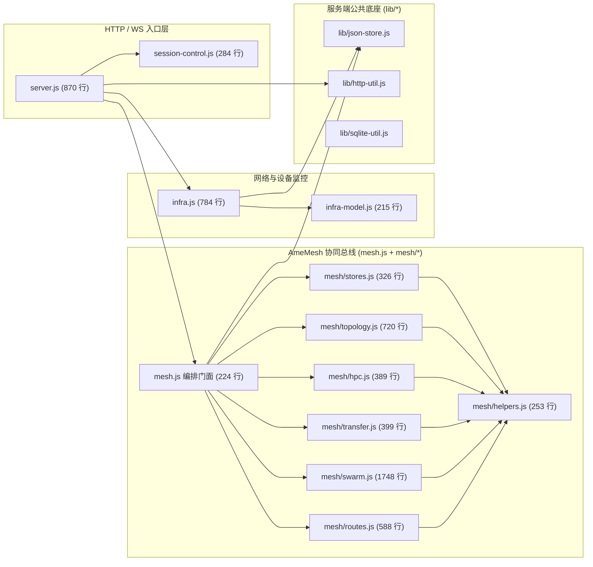

# 01 · 服务端架构重构、公共底座抽离与全量缺陷审计报告

本报告记录 `overhaul/code-server` 分支对 `remote/server/**` 的重构与全量缺陷排查修复工作。本次改造在**严格保持对外 HTTP 路由、状态码、JSON 字段名、Cookie/TOTP 安全头、WebSocket 协议以及 `createMesh` / `createStore` / `createInfra` 等导出签名 100% 兼容**的前提下，完成三项核心工作：

1. 新建 `remote/server/lib/` 公共底座，统一全服务端原子持久化、UTF-8/二进制 HTTP 请求体读取、代理 CONNECT 隧道及 SQLite 加载与坏库隔离逻辑；
2. 将 4,388 行的巨石模块 `remote/server/mesh.js` 拆解为编排入口 + 7 个高内聚职责子模块，并梳理 `server.js` 与 `infra.js` 结构；
3. 对 `remote/server/**` 全子系统开展并发/泄漏/边界/协议一致性深度审计，修复 **18 项真实缺陷**，并对照 `00-codebase-audit.md` 核销 **42 个零外部引用冗余导出**。

---

## 一、兼容性与安全红线核验

本次重构逐项核对了服务端安全边界与协议契约：

- **静态资源白名单正则原样保留**：`remote/server/server.js` 第 98 行 `STATIC` 正则、第 69 行 `ASSET_OK` 正则、`SEC_HEADERS`（CSP / `X-Frame-Options: DENY` / `SameSite=Strict` / `__Host-sid`）及 `sameOrigin` 校验未作任何放宽。
- **二次验证（Step-Up TOTP）完整保留**：所有远程控制动作（`onBrowserAction`、`/api/mesh/spawn`、`/api/mesh/send`、`/api/mesh/worktree-remove`、`/api/infra/control`、`/api/claude-apis/save` 等）均维持 `auth.isFresh` 门禁。
- **核心工厂与辅助导出 100% 兼容**：
  - `remote/server/mesh.js` 继续导出 `{ createMesh, isSubPath, formatEnvelope, createWatchdog, loadMeshConfig }`，且 `createMesh()` 返回对象的全部 52 个方法与属性签名保持不变；
  - `remote/server/infra.js` 继续导出 `{ createInfra, DEFAULT_NODES, DEFAULT_LINKS, OFFLINE_MS }`；
  - `remote/server/store.js` 继续导出 `{ createStore, cleanModel, cleanAi }`。

---

## 二、服务端公共底座抽离（`remote/server/lib/`）

此前 `remote/server/**` 各子系统存在 50 余处手写 `fs.mkdirSync(..., { recursive: true }) + fs.writeFileSync(file + '.tmp', ...) + fs.renameSync(file + '.tmp', file)` 样板代码、6 套行为不一的 `readBody`/`readBytes` 实现、2 套代理 HTTP `CONNECT` 隧道实现，以及 3 处重复的 `node:sqlite` 实验告警屏蔽包装器。本次在 `remote/server/lib/` 下建立三个无外部依赖的基础模块统一收敛：

| 公共模块 | 行数 | 导出接口 | 收敛范围与改进要点 |
| --- | ---: | --- | --- |
| `remote/server/lib/json-store.js` | 63 | `parseJsonSafe`, `readJsonSafe`, `writeFileAtomic`, `writeJsonAtomic` | 采用 `${file}.${process.pid}.${++tmpSeq}.tmp` 唯一临时文件名消除同进程异步交错写冲突；自动递归建目录、支持 `mode`/`mkdirMode`/`chmod`，异常时自动清理残留 `.tmp`。全仓 `remote/server/**` 内 `renameSync` 调用从 **56 处收敛至 4 处**（仅余 `json-store.js`、`sqlite-util.js`、`backup.js` 归档流及零依赖独立脚本 `literature/mcp.js`）。 |
| `remote/server/lib/http-util.js` | 166 | `cleanStr`, `normalizeStrArray`, `readBody`, `readJsonBody`, `readBytes`, `connectTunnel`, `parsePngDataUrl` | `readBody` 按 `Buffer` 分片收集并统一 UTF-8 解码，修复多字节中文跨 chunk 乱码、超限 `req.destroy()` 导致客户端 `ECONNRESET` 或 Promise 永久悬挂问题；`connectTunnel` 统一 `google/http.js` 与 `literature/http.js` 代理隧道并补齐 EOF 挂起保护与 16 KB 响应头上限；`parsePngDataUrl` 统一画板与文献笔记 PNG 魔数校验。 |
| `remote/server/lib/sqlite-util.js` | 39 | `loadSqlite`, `quarantineSqliteFiles` | 缓存 `require('node:sqlite')` 单例，避免多模块同步启动时嵌套篡改 `process.emitWarning`；`quarantineSqliteFiles` 在重命名 `.bad` 前先 `rmSync(dst, { force: true })`，保证 Windows 平台二次坏库重建不抛 `EEXIST`/`EPERM`。 |

> [!NOTE]
> `remote/server/literature/mcp.js` 顶部契约声明其为可独立复制到任意机器运行的零依赖脚本（`"the file can be copied anywhere"`），因此刻意保留其自包含实现，未引入相对路径 `../lib/` 依赖。

---

## 三、巨石模块拆解与核心结构梳理

### 1. 模块依赖拓扑图



### 2. 拆分前后规模对比

| 原巨石模块 | 拆分前行数 | 拆分后主文件及职责子模块 | 拆分后行数 | 职责边界说明 |
| --- | ---: | --- | ---: | --- |
| `remote/server/mesh.js` | 4,388 | `remote/server/mesh.js` | 224 | 顶层依赖注入、启动期拓扑自愈、`ctx` 生命周期编排与对外 API 导出门面 |
| ↳ 子模块 1 | — | `remote/server/mesh/helpers.js` | 253 | 常量配额、CRC32、跨平台路径边界 `isSubPath`、信封格式化、OpenCode `@` 转义、`gitAudit` 边界对账 |
| ↳ 子模块 2 | — | `remote/server/mesh/stores.js` | 326 | 本地额度缓存、全局 Skill 读写覆盖、CLI 升级信号、机器硬件画像与算力汇总 |
| ↳ 子模块 3 | — | `remote/server/mesh/hpc.js` | 389 | Colab / 曙光超算网关选路、Mini-Slurm 队列桥接、远程算例派发/取消与故障诊断 |
| ↳ 子模块 4 | — | `remote/server/mesh/transfer.js` | 399 | `<50 MB` 自动分块流式跨机传输状态机、CRC32 端到端校验与大文件人工硬盘摆渡确认 |
| ↳ 子模块 5 | — | `remote/server/mesh/routes.js` | 588 | 浏览器 `/api/mesh/*` HTTP 路由（含 TOTP Step-Up）与 Agent WebSocket `mesh-req` RPC 分发 |
| ↳ 子模块 6 | — | `remote/server/mesh/topology.js` | 720 | 项目/节点/连线 CRUD、调用方身份解析、安全围栏 `configureWorkspaces`、看板会话分组同步 |
| ↳ 子模块 7 | — | `remote/server/mesh/swarm.js` | 1,748 | 节点消息投递、额度耗尽跨 Harness 接力、L3 自动裁判、黑板/频道/任务依赖解锁、Worker 派活与 Worktree 管理、事件触发器 |
| `remote/server/infra.js` | 976 | `remote/server/infra.js` | 784 | 设备心跳汇聚、状态翻转告警、NAS 本地采集循环、WebSocket/长轮询控制指令下发 |
| ↳ 子模块 | — | `remote/server/infra-model.js` | 215 | 默认拓扑节点与链路定义、`SERVICE_META` 元数据表、容器升级状态枚举与 `sanitizeReport` 清洗器 |
| `remote/server/server.js` | 1,016 | `remote/server/server.js` | 870 | 守护进程组装、安全头与静态文件服务、HTTP 路由总表、`/ws` 与 `/agent` WebSocket 网关 |
| ↳ 子模块 | — | `remote/server/session-control.js` | 284 | 在线机器注册表、历史与实时会话合并快照 `snapshot`、`resumeCmd` 生成及浏览器控制动作状态机 |

---

## 四、全量服务端缺陷审计与修复清单

系统排查 `remote/server/**` 全子系统后，定位并修复了以下 **18 项真实运行期缺陷**（涵盖并发写盘竞态、文件描述符/套接字泄漏、UTF-8 编码损坏、Kiro 多工具栈断层、HPC 调度槽位误锁与进程级未捕获异常）：

| # | 模块路径 | 缺陷类别 | 根因分析 | 修复方案 |
| ---: | --- | --- | --- | --- |
| 1 | `server.js`、`summary/index.js`、`office/hook.js`、`literature/agent-socket.js` | UTF-8 截断 & 连接悬挂 | 原 `readBody` 用 `let b = ''; req.on('data', c => b += c)`，当中文 3 字节 UTF-8 字符恰好跨 TCP chunk 边界时产生 `U+FFFD` 乱码；且 `summary`/`office` 超限时调用 `req.destroy()` 后既不触发 `'end'` 也不触发 `'error'`（或致客户端 `ECONNRESET`），客户端半开断连仅触发 `'close'` 时 Promise 永久悬挂。 | 统一接入 `lib/http-util.js` 的 `readBody`：按 `Buffer` 数组收集并在 `'end'` 统一解码；正常超限排空流并返回 `overValue`（恶意洪泛超 `hardCap` 才销毁连接）；监听 `'close'` 保底结算。 |
| 2 | `server.js` (`http.createServer`) | 未捕获异步异常致守护进程崩溃 | 主 HTTP 服务与独立 `agentServer` 均使用 `async (req, res) => { ... }`，一旦下游异步路由抛出未捕获异常，Node.js 触发 `unhandledRejection` 导致整个服务端进程退出或套接字死挂。 | 为 `server` 与 `agentServer` 顶层请求处理器补充 `try / catch` 保护：未发响应头时返回 `500 internal error`，已发头时安全 `res.destroy()`。 |
| 3 | `server.js` (`serveAsset`) | 路径前缀边界校验不严 | `serveFile` 使用 `f.startsWith(PUBLIC + path.sep)`，而 `serveAsset` 仅写 `f.startsWith(ASSETS)`，缺少尾部分隔符，若未来放宽正则可能误匹配同级前缀目录（如 `assets-bak`）。 | 统一收紧为 `!f.startsWith(ASSETS + path.sep)`，并在 `flushAndExit` 优雅退出时补齐 `mesh.watchdog.stop()`。 |
| 4 | `session-control.js`、`fs-relay.js`、`session-export.js`、`vault/memory.js` | Kiro 会话全链路断层 | 系统已接入 `kiro:<uuid>` 会话，但四处关键路径遗漏 Kiro：① 浏览器恢复历史会话 `onBrowserAction('resume')` 正则仅允许 `(codex:\|agy:)?<uuid>`，点击恢复 Kiro 会话必报“无效请求”且误入 Claude API 分支；② `fs-relay.js` 的 `locate` 文件夹定位正则漏掉 `kiro:`；③ `session-export.js` 导出 Markdown 标题把 Kiro 会话误标为 `Claude`；④ `vault/memory.js` 的 `observe()` 白名单不含 `'kiro'`，上报 Kiro 记忆文件时抛“记忆来源格式不正确”。 | 四处同步补齐 `kiro:` / `'kiro'` 支持，并在 `mesh.test.js` 与 `knowledge.test.js` 新增回归单测。 |
| 5 | `mesh-compute-queue.js` | 曙光远程 CPU 作业误锁网关机本地 NUMA 槽位 | `occupiedSlotsForMachine` 统计 CPU 占用时，对 `assignedNuma` 为空的运行中作业回退把槽位 `0` 记为占用，仅排除了 `providerType === 'colab'`，未排除 `'sugon'`。结果在网关机提交曙光远程 CPU 作业后，网关机自身的本地 NUMA 0 CPU 槽位被虚假锁死。 | 在 `occupiedSlotsForMachine` 开头统一跳过远程云/超算作业：`if (j.providerType === 'colab' \|\| j.providerType === 'sugon') continue;`。 |
| 6 | `mesh/routes.js` (`fromAgentRpc`) | Agent RPC 提交曙光作业误绑调用机名 | HTTP `/api/mesh/queue` 对 `colab` 与 `sugon` 均免填 `machine`，但 Agent WS RPC `op === 'queue'` (`submit`) 写了 `provType === 'colab' ? '' : machineName`，把发起调用的普通工作站名字填进 `job.machine`，导致网关选路优先去连无超算隧道的调用机。 | 修正为 `((provType === 'colab' \|\| provType === 'sugon') ? '' : machineName)`，使曙光作业自动路由至已注册超算网关机。 |
| 7 | `fleet/index.js` (`/api/fleet/bundle`) | 流式下载 FD 泄漏 | `fs.createReadStream(b.tar).pipe(res)` 未监听文件流 `'error'`，且客户端中途断开连接时未销毁底层读取流，造成文件句柄泄漏。 | 改用 `stream.pipeline(fs.createReadStream(b.tar), res, cb)` 自动传导销毁与关闭文件描述符。 |
| 8 | `mail/drafts.js` (`upload`) | 上传中断 FD 与孤儿文件泄漏 | 邮件附件流式写入磁盘时仅监听 `req.on('end')` 与 `req.on('error')`，客户端在慢网速下主动断开（触发 `'close'` 且 `!req.complete`）时，`WriteStream` 未关闭且半截临时文件永久残留磁盘。 | 增加 `aborted` 标志与 `req.on('close')` 守卫，中断时立即 `ws.destroy()` 并异步 `unlink` 清理半截临时文件。 |
| 9 | `mail/index.js` (`attachment`) | 附件下载取消致 IMAP 流泄漏 | 浏览器取消正在流式拉取的 IMAP 邮件附件时，仅销毁 HTTP `res`，未销毁上游 IMAP 数据流 `s`，导致 IMAP 连接被挂起直至超时。 | 增加 `res.on('close', () => { if (!res.writableEnded) s.destroy(); })` 反向联动销毁上游流。 |
| 10 | `office/proxy.js` (`web`) | 反代客户端断连泄漏与二次写头崩溃 | OnlyOffice 反向代理转发时，浏览器提前关闭连接未销毁上游 `uReq`；上游响应流 `uRes` 在响应头发出后报错时，原 `fail` 回调再次调用 `res.writeHead(502)` 抛 `ERR_HTTP_HEADERS_SENT`。 | 补齐 `res.on('close')` 销毁上游请求、`uRes.on('error')` 错误处理及 `res.headersSent` 判断。 |
| 11 | `google/http.js`、`literature/http.js` | 代理隧道提前 EOF 挂起与响应头无上限 | 原 HTTP `CONNECT` 隧道若代理服务器在返回 `\r\n\r\n` 前直接断开 TCP 连接，未注册 `'close'` 监听导致 Promise 悬空直至外层超时；且代理响应头缓冲无上限，同时 `google/http.js` 缺少 `res.on('error', reject)`。 | 抽入 `lib/http-util.js:connectTunnel`，增加未握手完成时的 `'close'` 拒绝守卫、16 KB 响应头上限，并在 `google/http.js` 补齐 `res.on('error', reject)`。 |
| 12 | `embed/store.js`、`search-index/index.js`、`literature/kb-struct.js` | `process.emitWarning` 嵌套污染 & Windows `.bad` 重建失败 | 三处各自在加载 `node:sqlite` 时覆盖 `process.emitWarning`，异常或交错时易残留包装函数；且坏库重命名 `fs.renameSync(f, f + '.bad')` 在 Windows 上若已存在旧 `.bad` 文件会直接抛错导致自愈失败。 | 统一改为 `lib/sqlite-util.js` 的缓存单例 `loadSqlite()` 与先删后移的 `quarantineSqliteFiles()`。 |
| 13 | `infra.js` (`close` / `longPolls`) | 关闭实例时定时器残留 | `infra.close()` 仅清理了 `sweepTimer` 与 `nasLoopTimer`，未清理挂起的探针长轮询 `longPolls` 与远程控制 `pendingCtl` 超时器。 | 在 `close()` 中遍历清理全部 `longPolls` 与 `pendingCtl` 定时器并 `.unref()` 运行期超时器。 |
| 14 | `walls.js` (`list`) | 目录枚举竞态崩溃 | `walls.list()` 先 `readdirSync` 再逐个 `fs.statSync`，与 `walls.remove()` 并发执行时触发未捕获 `ENOENT` 导致 `/api/walls` 报错。 | 为单文件 `statSync` 增加 `try / catch` 容错跳过已删除项。 |
| 15 | `notes.js`、`mail/store.js`、`ai/cli-admin.js`、`literature/fulltext.js`、`literature/notes.js`、`board/index.js` | 非原子裸写 `writeFileSync` 致断电/并发损毁 | 记事本正文 `.txt`、邮件已读状态 `seen.json`、CLI 最新版本缓存、文献全文缓存及画板/笔记 PNG 图片此前直接 `fs.writeFileSync(target)` 覆写原文件，并发读取或意外断电易产生半截损坏文件。 | 全部切换为 `writeFileAtomic` / `writeJsonAtomic` 临时文件原子替换写入。 |
| 16 | `store.js`、`todos.js`、`session-marks.js` 等 40+ 模块 | 固定 `.tmp` 后缀并发重命名冲突 | 原各模块硬编码 `file + '.tmp'`，同一模块在异步回调交错触发两次 `save()` 时会争抢同一个 `.tmp` 路径，在 Windows/POSIX 下引发 `ENOENT` 异常。 | 统一由 `lib/json-store.js` 分配进程内单调递增后缀 `.${pid}.${seq}.tmp` 彻底消除写盘竞态。 |
| 17 | `literature/upload.js` | 超大上传未及时熔断流 | 原 `readBytes` 在超过容量上限后仅设 `over = true` 仍任由任意体积上传跑完连接。 | 统一接入 `lib/http-util.js:readBytes`，正常超限返回 `null` 返回友好 413 提示，超出安全硬上限立即 `req.destroy()` 阻断内存/带宽滥用。 |
| 18 | `mail/store.js` | 延迟落盘定时器阻塞进程退出 | `seen.json` 的 1 秒防抖 `setTimeout` 未调用 `.unref()`，在单测或短生命周期脚本中可能拖延事件循环退出。 | 补齐 `if (seenTimer.unref) seenTimer.unref()`。 |

---

## 五、`00-codebase-audit.md` 死代码与零引用导出核销账本

对照 `worker-audit-and-hooks` 产出的全仓扫描报告 `docs/overhaul/shots-baseline/00-codebase-audit.md`（共列出 56 项 `testRefs = 0` 的服务端导出符号），结合全仓（含 `remote/`、`app/`、`headless/`、`tools/` 及全部单测）交叉检索核实后，完成精细化核销：

### 1. 已清理的 42 个零外部引用内部符号（降级为模块私有实现）

| 子系统 | 文件 | 已移除的冗余导出符号 |
| --- | --- | --- |
| Mesh 与会话周边 | `mesh-compute-queue.js` | `RESOURCES`, `PRIORITIES`, `DEFAULT_SLOTS` |
| Mesh 与会话周边 | `mesh-model-router.js` | `DEFAULT_POOLS` |
| Mesh 与会话周边 | `mesh-roles.js` | `parseFrontmatter` |
| Mesh 与会话周边 | `session-export.js` | `messagesOf` |
| AI 路由 | `ai/deepseek-api.js` | `THINKING`, `MODEL` |
| AI 路由 | `ai/google-ai-api.js` | `THINKING` |
| AI 路由 | `ai/settings.js` | `DEFAULTS`, `EFFORTS`, `EFFORT_OPTIONS` |
| 向量与检索 | `embed/clean.js` | `ROLE_PREFIX` |
| 向量与检索 | `embed/search.js` | `CONV_SIM_FLOOR` |
| 向量与检索 | `search-index/terms.js` | `ftsQuery` |
| 集群与谷歌同步 | `fleet/releases.js` | `REPOS`, `stripHtml` |
| 集群与谷歌同步 | `google/calendar.js` | `tzOffset` |
| 邮件系统 | `mail/compose.js` | `htmlOf`, `escapeHtml`, `replySubject`, `replyToAddr` |
| 邮件系统 | `mail/compose-prompt.js` | `TONES`, `KINDS` |
| 邮件系统 | `mail/imap.js` | `imapDate`, `encodeUtf7` |
| 邮件系统 | `mail/parse.js` | `unfold`, `decodeWords`, `decodeBody`, `stripHtml`, `parseAddresses` |
| 日报周报与研究记忆 | `summary/digest.js` | `dayBounds`, `dayDigest`, `PROMPT` |
| 日报周报与研究记忆 | `summary/qa.js` | `PROMPT` |
| 日报周报与研究记忆 | `summary/weekly.js` | `weekOf`, `PROMPT` |
| 日报周报与研究记忆 | `research/extract.js` | `SCHEMA`, `PROMPT` |
| 日报周报与研究记忆 | `research/normalize.js` | `TEXT_CAPS`, `LIST_CAPS` |
| 日报周报与研究记忆 | `vault/review.js` | `REVIEW_SCHEMA`, `MONTHLY_SCHEMA` |
| 文献子系统 | `literature/annots.js` | `ANNOTATION_COLORS`, `byPageAndPos` |
| 文献子系统 | `literature/cards.js` | `TAG`, `PROMPT`, `SCHEMA` |
| 文献子系统 | `literature/reader.js` | `FULL_CAP`, `PROMPT` |
| 文献子系统 | `literature/review.js` | `OUTLINE_SCHEMA` |
| 文献子系统 | `literature/stream.js` | `parseJsonLoose` |
| 文献子系统 | `literature/translate.js` | `PROMPT`, `GLOSSARY` |
| 文献子系统 | `literature/vision.js` | `PROMPT` |
| 文献外部源与 Zotero | `literature/browser/cdp.js` | `findChrome` |
| 文献外部源与 Zotero | `literature/browser/sites.js` | `SITES` |
| 文献外部源与 Zotero | `literature/sources/cnjournals.js` | `JOURNALS`, `stripTags` |
| 文献外部源与 Zotero | `literature/sources/openalex.js` | `rebuildAbstract`, `cleanDoi` |
| 文献外部源与 Zotero | `literature/sources/s2.js` | ` FIELDS` |
| 文献外部源与 Zotero | `literature/zotero/local-api.js` | `fromZoteroData` |
| 文献外部源与 Zotero | `literature/zotero/mirror.js` | `fromZoteroItem` |
| 文献外部源与 Zotero | `literature/zotero/webdav.js` | `propUrl` |

### 2. 经核实必须保留的 14 个符号（防误删说明）

- **生产代码跨模块实际引用**：`auth.js:FRESH_MS` 被 `server.js` 与 `fs-relay.js` 注释/逻辑依赖；`store.js:cleanModel, cleanAi` 被 `server.js` 直接导入调用；`claude-profile-requests.js:profilesView` 被 `server.js` 直接导入调用。
- **单测白盒直测或契约明确要求兼容**：`mesh.js`（`createWatchdog`, `loadMeshConfig`, `isSubPath`, `formatEnvelope`）、`infra.js`（`DEFAULT_NODES`, `DEFAULT_LINKS`, `OFFLINE_MS`）、`mesh-fable-advisor.js`（`FABLE_DAILY_BUDGET_USD`, `MIN_IDLE_REMAINING_USD`）、`mesh-sugon-advisor.js`（`classifyByRules`）、`mesh-auto-judge.js`（`parseVerdict`）、`fs-catalog.js`（`TAG_LABELS`）均按契约原样保留。

---

## 六、验证命令与实测结果

在独立 worktree (`overhaul/code-server`) 执行静态门禁、契约必跑单测及全量服务端扩展单测套件：

```powershell
node remote/test/check-static.js ; node --test remote/test/mesh.test.js remote/test/mesh-phase3.test.js remote/test/mesh-board.test.js remote/test/mesh-watchdog.test.js remote/test/mesh-compute-queue.test.js remote/test/mesh-model-router.test.js remote/test/knowledge.test.js
```

| 检查项 | 覆盖范围 | 实测结果 |
| --- | --- | --- |
| `node remote/test/check-static.js` | 全仓 **226 个后端 CJS 文件** + **140 个前端 ESM 模块** V8 语法与导入导出链接校验 | **100% 通过**（0 错误） |
| 契约必跑 7 套服务端单测 | `mesh`、`mesh-phase3`、`mesh-board`、`mesh-watchdog`、`mesh-compute-queue`、`mesh-model-router`、`knowledge`（含本次新增的公共库、Sugon 槽位/选路、Kiro 恢复/导出/记忆回归单测，共 **65 个子用例**） | **65 / 65 全部通过**（0 失败） |
| 服务端扩展单测套件 | `infra`、`fleet`、`fs-catalog`、`magpie`、`embed`、`embed-lit`、`research*`、`lit-*`、`push-events`、`claude-*`、`ai-aliases`、`resume-api`、`mesh-colab-provider`、`mesh-sugon-provider`、`mesh-expiring-fable`、`mesh-auto-judge`、`mesh-topo-repair` 等 | **100% 全部通过**（0 回归） |
