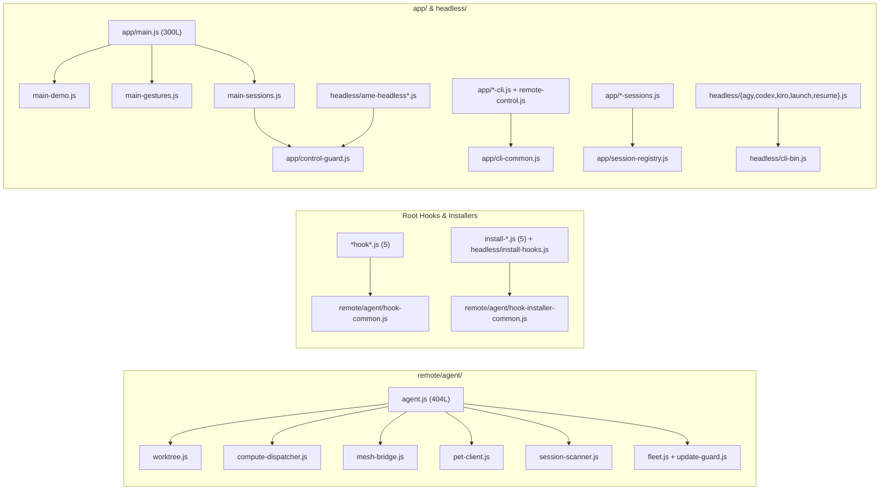

# 03 · Agent / Hooks / Headless / 桌宠端去重、巨石拆分与边界 Bug 修复报告

> 分支：`overhaul/code-agent-pet`（节点：`worker-audit-and-hooks`）  
> 原则：**对外 HTTP/IPC/WebSocket 协议、CLI 参数、环境变量及 `app/bubble.html` / CSS 视觉样式 100% 保持不变**；开发目录自动更新保护零削弱；Fleet 更新包静态依赖 100% 闭环。

---

## 1. 巨石模块拆分总览

三大超长核心文件（合计 **3,959 行**）均已按职责边界拆分为高内聚子模块，单文件全部降至 **≤ 535 行**：

| 原巨石模块 | 拆分前行数 | 拆分后主入口 | 拆出子模块与职责 |
| :--- | ---: | :--- | :--- |
| `remote/agent/agent.js` | **1,582** | `remote/agent/agent.js`（**404 行**）：配置加载、WebSocket 重连心跳、RPC 路由与生命周期编排 | • `remote/agent/worktree.js`（213 行）：`createGitWorktree` / `checkGitWorktree` / `removeGitWorktree` / `collectGitAudit` • `remote/agent/compute-dispatcher.js`（316 行）：后台算力任务 `mesh_run` 进程池、日志流、恢复与取消 • `remote/agent/mesh-bridge.js`（345 行）：本地 `127.0.0.1:3941` HTTP 桥、MCP/Mesh RPC 转发、离线事件队列落盘重放、文件传输与 `globToRegex` • `remote/agent/pet-client.js`（185 行）：本地桌宠/无头 `127.0.0.1:3940` HTTP 客户端与 `apiOf` 提供商推断 • `remote/agent/session-scanner.js`（535 行）：五类 CLI 会话增量扫描、JSONL Tail 推送、`deriveState` 与 `projectOf` |
| `app/renderer.js` | **1,369** | `app/renderer.js`（**179 行**）：`update(dt)` 主步进、DPI `resize`、`drawFrame()` 渲染管线与资源启动加载 | • `app/renderer-rig.js`（503 行）：场景常量、双浮手运动学与避让弹簧、身体/双腿物理、平滑视线合成、前发与双马尾绘制 • `app/renderer-mood.js`（340 行）：表情优先级状态机、切脸弹跳动画、KAngel 变身彩蛋、深夜与久坐提醒气泡 • `app/renderer-idle-ui.js`（319 行）：哈欠/伸懒腰/喝茶小动作与茶杯时间轴、P-chan 伴侣、像素级鼠标穿透/触控轮廓、摸头与拖拽手势、Claude 状态联动 • 通过 `app/index.html` 按序引入经典脚本，保留 60fps 渲染循环与 `AME_DEMO*` `executeJavaScript` 所需的顶层词法绑定（`app/bubble.html` 与全部样式未做任何修改） |
| `app/main.js` | **1,008** | `app/main.js`（**300 行**）：Electron 单实例锁、透明置顶窗口、系统托盘菜单、全局键鼠钩子与穿透调度 | • `app/main-demo.js`（286 行）：`AME_DEMO` / `AME_DEMO_KB` / `AME_DEMO_FACES` / `AME_DEMO_GAZE` / `AME_DEMO_IDLE` / `AME_DEMO_BUBBLE` / `AME_DEMO_NAG` / `AME_DEMO_KANGEL` 演示与自动截图流水线 • `app/main-gestures.js`（320 行）：气泡面板停靠定位、P-chan 折叠持久态、鼠标/触屏拖拽与缩放手势 • `app/main-sessions.js`（406 行）：会话注册表、超时清理、JSONL 对话增量轮询、`/btw` 合并及 `127.0.0.1:3940` 本地 HTTP 服务 |

---

## 2. 跨文件重复逻辑抽取清单

针对 `00-codebase-audit.md` 识别出的高频复制粘贴簇，按打包边界（Fleet 更新包 vs Electron `app.asar`）抽取为 6 个零外部依赖公共模块：

| 新增公共模块 | 复用消费方 | 消除的重复逻辑 |
| :--- | :--- | :--- |
| `remote/agent/hook-common.js`（198 行） | `agy-hook.js`、`codex-hook.js`、`kiro-hook.js`、`hook-relay.js`、`permission-hook.js` | `cut` / `cutRawWs`、`baseName`、`looksLikeToolFailure`、FD 安全 `readFileTail`、`postLoopbackJson`、带总预算与流式 JSON 早解析的 `runJsonHook` |
| `remote/agent/hook-installer-common.js`（94 行） | `install-agy-hooks.js`、`install-codex-hooks.js`、`install-kiro-hooks.js`、`install-mesh-mcp.js`、`install-opencode-plugin.js`、`headless/install-hooks.js`、`remote/agent/fleet.js` | `fwdSlash`、`psQuote`、`winCmdQuote`（`CommandLineToArgvW` 规范）、`nodeOnPath`、`hookCommandFor`、`psCallCommand`、`isOurHookCommand`、去 BOM `readJsonFile`、带唯一后缀与异常清理的 `atomicWriteText` |
| `app/cli-common.js`（98 行） | `app/agy-cli.js`、`app/codex-cli.js`、`app/kiro-cli.js`、`app/remote-control.js`、`headless/launch.js` | `cleanMeshEnv`、进程祖先链查找 `findCliInChain`、TUI 多行 Ctrl+J 输入 `sendMultiline`、子进程轮询 `waitCliStarted`、Windows `.exe`/`.cmd` 解析 `findWinCommand` |
| `app/session-registry.js`（92 行） | `app/agy-sessions.js`、`app/codex-sessions.js`、`app/kiro-sessions.js` | `~/.ametyping/<provider>-sessions/<uuid>.json` 原子写盘、PID 去重、进程身份校验与读写缓存工厂 `createSessionRegistry` |
| `app/control-guard.js`（68 行） | `app/main-sessions.js`、`headless/ame-headless.js`、`headless/ame-headless-win.js` | 远控关闭状态下拦截审批路由 `PERM_END` / `createControlGuard`、CLI 更新静默抑制窗口 `createCliUpdateTracker` |
| `headless/cli-bin.js`（28 行） | `headless/agy.js`、`headless/codex.js`、`headless/kiro.js`、`headless/launch.js`、`headless/resume.js` | Unix 可执行路径探测 `findUnixBin` 与 tmux pane 子进程树遍历 `makeThreadOf` |

---

## 3. 发现并修复的真实边界与并发 Bug

1. **Windows 端 Kiro 会话无法定位、空闲 60 秒被误判崩溃清除、重启丢失领养（`app/session-locate.js`、`app/session-adopt.js`）**
   - **根因**：`session-locate.js` 的 `locate()` 仅处理了 `codex` 与 `agy`，未接入 `kiro`；且 `procAlive()` 漏掉了 `kiroCli.KIRO_EXE`。导致 Windows 端任何活跃 `kiro-cli.exe` 会话在静默 60 秒触发存活巡检时返回 `procAlive === false` 而被误删；同时 `session-adopt.js` 重启恢复列表也漏掉了 `kiroSessions`。
   - **修复**：在 `PROVIDER_LOCATORS`、`procAlive()` 与 `CLI_PROVIDERS` 中完整接入 `kiroCli` / `kiroSessions` / `kiroRecords`，并补齐回归单测（`app/kiro-support.test.js`）。

2. **Fleet 部署与 Hook 状态巡检漏掉 Kiro（`remote/deploy/deploy.js`、`remote/agent/fleet.js`）**
   - **根因**：`deploy.js` 的 `HOOKS` 列表和本机同步步骤缺少 `kiro-hook.js` / `install-kiro-hooks.js`；`fleet.js` 的 `hookStatus()` 与 `hookTasks()` 未检测/同步 `~/.kiro/agents/default.json`。
   - **修复**：将 `kiro-hook.js`、`install-kiro-hooks.js`、`remote/agent/hook-common.js`、`remote/agent/hook-installer-common.js`、`app/console-bridge.ps1` 全部纳入 `deploy.js` `HOOKS`，并在 `fleet.js` 补齐 Kiro 状态检测与一键同步任务。

3. **Windows 无头服务动态路径拼接导致 `deploy.js` `depsOf()` 漏扫 `app/` 依赖（`headless/ame-headless-win.js`、`remote/deploy/deploy.js`）**
   - **根因**：`deploy-lib.js` 的 `depsOf()` 通过正则扫描静态 `require('./...')` / `require('../...')` 字面量追踪跨目录依赖；而 `headless/ame-headless-win.js` 原先使用 `require(path.join(APP, 'bridge'))` 动态拼接，导致 `app/bridge.js`、`app/remote-control.js`、`app/session-adopt.js`、`app/session-locate.js` 等无法通过静态分析从 `headless` 入口被发现；同时 `deploy.js` 原先只传 `['remote/agent', 'headless']` 未传入 `HOOKS`。
   - **修复**：将 `headless/ame-headless-win.js` 全部改为静态相对路径 `require('../app/...')`，并将 `deploy.js` 依赖根扩展为 `depsOf(commit, ['remote/agent', 'headless', ...HOOKS])`，由 `remote/test/fleet.test.js` 静态可达性单测永久守护。

4. **Hook 进程文件句柄泄漏、UTF-8 多字节截断与父进程未关 stdin 挂起（`hook-relay.js`、`kiro-hook.js`、`permission-hook.js` → `remote/agent/hook-common.js`）**
   - **根因**：
     - `hook-relay.js` 的 `readTail` 执行 `fs.openSync` + `fs.readSync` 未包 `try ... finally { fs.closeSync(fd); }`，读取异常时泄漏文件描述符；
     - `hook-relay.js` 读取 `process.stdin` 未调 `setEncoding('utf8')` 且无长度上限，跨 chunk 切分中文多字节字符会产生乱码；
     - `kiro-hook.js` 与 `hook-relay.js` 必须等 `stdin` 触发 `'end'` 才解析 JSON，当宿主 shell 写完 JSON 未立即关闭管道时一直卡死到超时丢事件，且 `kiro-hook.js` 在慢输入后重置 700ms HTTP 计时器会超出 2s Hook 预算。
   - **修复**：统一收口至 `readFileTail`（严格 `try/finally` 关句柄）与 `runJsonHook`（UTF-8 解码、2MB 上限、收到完整 JSON 立即停读派发、共享总截止时间预算）。

5. **Windows WMI 启动守护 `CommandLineToArgvW` 尾部反斜杠转义损坏与特殊路径引号漏转义（`remote/agent/fleet.js`、`remote/agent/hook-installer-common.js`、`headless/install-hooks.js`）**
   - **根因**：
     - `fleet.js` `startGuard` 原先用 `'"' + a.replace(/"/g, '') + '"'` 构造 WMI `CommandLine`，当 `--root D:\repo\` 带尾部反斜杠时会拼成 `"D:\repo\"`，按 Windows `CommandLineToArgvW` 规则 `\"` 会吃掉闭合引号并吞并后续参数，导致重启回滚守护启动失败；
     - `hookCommandFor` 原先仅对含空白字符的路径加引号，遇到不含空格但含 `()`、`&`、`;` 的目录（如 `D:/ame(dev)/...`）在 shell 中解析报错；
     - `headless/install-hooks.js` 未剥离 UTF-8 BOM 且每次无变更运行都生成冗余 `.bak-*` 备份。
   - **修复**：实现标准 `winCmdQuote` + `psQuote` 组合，扩展 `hookCommandFor` 元字符检测，并为 `headless/install-hooks.js` 增加去 BOM、幂等比对与原子写盘。

6. **`petCall` 连接异常关闭时 Promise 永不 settle 锁死 `agent.js` 主循环（`remote/agent/pet-client.js`）**
   - **根因**：`agent.js` 原 `petCall` 在响应超时或超过 4MB 调用 `req.destroy()` 时未传 Error，Node `http` 流可能仅触发 `'close'` 而不触发 `'end'` 或 `'error'`，导致 Promise 永久挂起，`agent.js` 中 `ticking = true` 被永久锁死，停止上报会话心跳。
   - **修复**：在 `pet-client.js` 中引入幂等 `finish()`，同时覆盖 `'end'`、`'close'`、`'error'`、`'timeout'` 与 9 秒硬超时兜底。

7. **WebSocket 断连未释放 `meshPending` 及离线 Mesh 事件冲洗竞态丢失（`remote/agent/mesh-bridge.js`）**
   - **根因**：原 `agent.js` 在 WS `'close'` 时只清理了 `mcpPending`，漏掉了 `meshPending`（导致本地 CLI 阻塞等待 20s 超时）；同时 `flushPendingMeshEvents()` 在未确认 WS 在线的情况下先把 `pending-mesh-events.json` 改名并在末尾 `unlinkSync`，断网瞬间重放会导致事件静默丢失。
   - **修复**：`meshBridge.onDisconnect()` 同步立即结算 `mcpPending` 与 `meshPending`；`flushPendingMeshEvents()` 全程检查 `isOnline()`，断线时将未发送事件写回持久化队列。

8. **`app/*-records.js` 时间戳 `NaN`、`agy-records` $O(N^2)$ 扫盘风暴与无界缓存增长（`app/agy-records.js`、`app/codex-records.js`、`app/kiro-records.js`、`app/opencode-records.js`、`headless/sessions-win.js`）**
   - **根因**：
     - `agy-records.js` 每当活跃 `transcript.jsonl` 的 `mtimeMs` 变化导致 `metaOf` 缓存失效时，`subagentDescriptor` 都会全量 `readdirSync(brain)` 并逐个读取父会话 `transcript.jsonl`（全仓活跃多会话时每 10 秒触发 $O(N^2)$ 同步读盘）；
     - `agy-records.js` 与 `codex-records.js` 未拦截非法时间字符串产生的 `Date.parse(...) -> NaN`（JSON 序列化后变成 `t: null`）；
     - `codex-records.js` / `kiro-records.js` / `opencode-records.js` 在模块加载时固化了环境变量目录，且 `metaCache` 无上限；
     - `headless/sessions-win.js` 漏了 `s.provider === 'opencode'` 的 `via` 判定，`headless/ame-headless-win.js` `/control/state` 漏返回 `cliUpdates`。
   - **修复**：为 `agy-records.js` 增加按 root 隔离的 5 秒 TTL 子代理索引缓存；全部 `*-records.js` 缓存限制为 500 条并动态读取环境变量；修复 `NaN` 时间戳回退与 Windows 无头端 `opencode` / `cliUpdates` 对齐。

---

## 4. 保护铁律核验

- **开发目录永不自动更新保护**：`remote/agent/update-guard.js` 未做任何逻辑改动；`remote/agent/fleet.js` `version()` 与 `apply()` 完整保留 `cfg.autoUpdate === false`、`.git` 为文件（linked worktree）、`worktree > 1`、`branch !== 'main'`、`dirtyFiles.length > 0` 五重阻断保护，经 `remote/test/fleet.test.js` 实测验证通过。
- **视觉零触碰边界**：`app/bubble.html` 及全仓所有 `.css` 文件零修改。
- **Fleet 更新包完整性**：`remote/deploy/deploy.js` 的 `HOOKS` 与 `depsOf(commit, ['remote/agent', 'headless', ...HOOKS])` 经静态依赖遍历单测验证，所有新增子模块与公共模块 100% 纳入更新树。

---

## 5. 验证结果摘要

| 检查项 | 命令 | 结果 |
| :--- | :--- | :--- |
| 全仓确定性 AST/Token 审计 | `node tools/audit-codebase.js` | **PASS**（同步输出至 `docs/overhaul/00-codebase-audit.md` 与 `shots-baseline/00-codebase-audit.md`，超长文件减少 3 个核心巨石） |
| 全仓 CJS + ESM 静态语法与导入导出校验 | `node remote/test/check-static.js` | **PASS**（221 CJS + 140 ESM 全量校验通过） |
| 渲染进程 11 脚本同作用域帧循环模拟 | `vm.runInContext` 加载 `app/index.html` 全部 11 个脚本并执行 `update` / `drawFrame` / `onKey` / `startAct` | **PASS**（零重名声明、零未定义符号） |
| 关联单元与集成测试全集 | `node --test agy-hook.test.js codex-hook.test.js kiro-hook.test.js install-mesh-mcp.test.js app/agy-support.test.js app/codex-support.test.js app/kiro-support.test.js app/opencode.test.js remote/test/fleet.test.js remote/test/launch-mesh-env.test.js` | **PASS**（**129 / 129 测试全部通过，0 失败**） |
