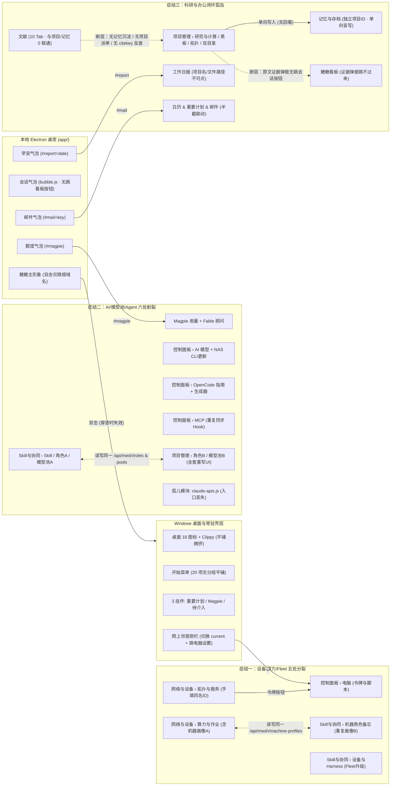
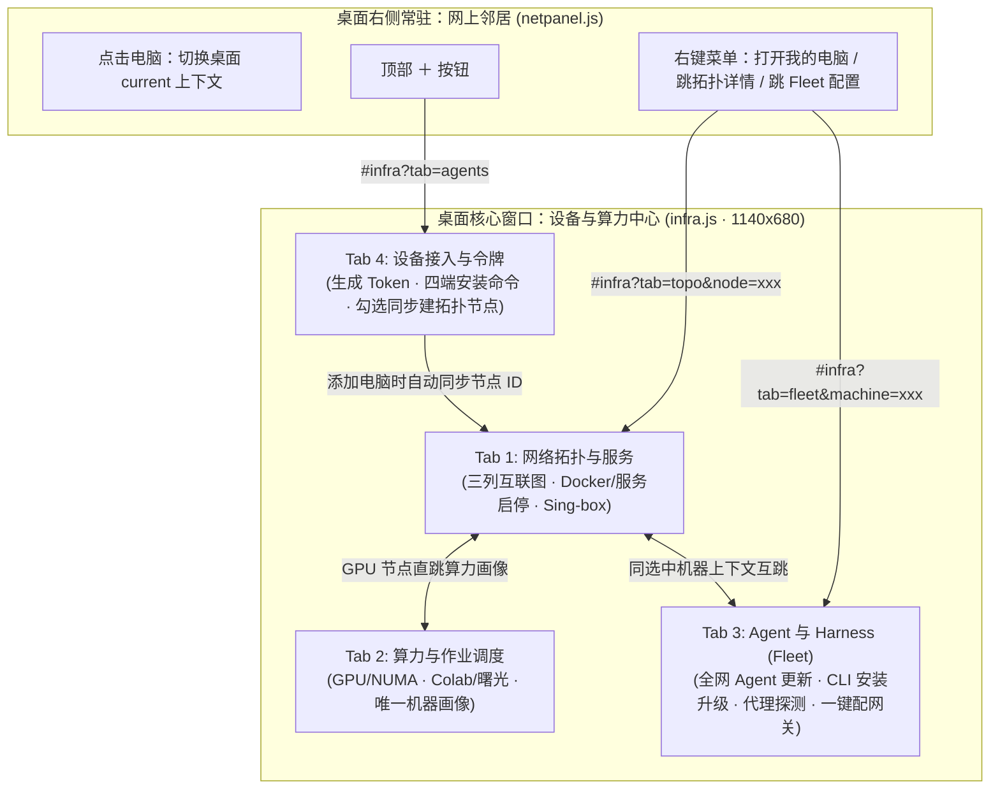
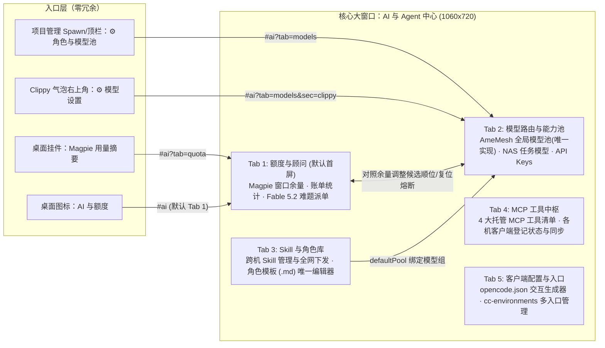
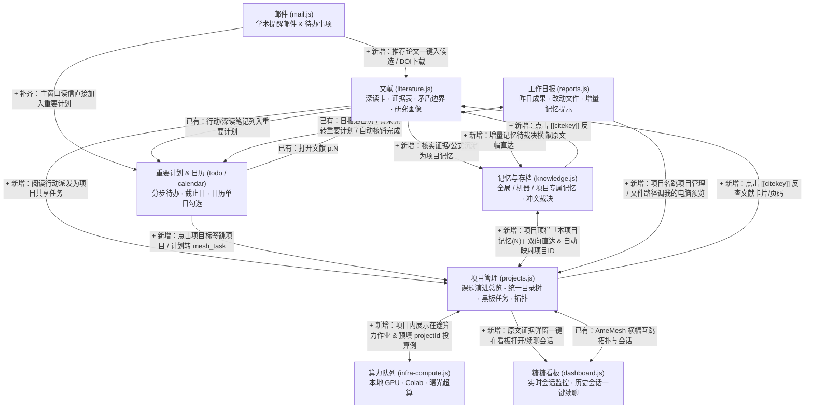

# Windose 功能统筹、页面归并与跨模块串联重构方案

> **文档状态**：只读诊断与架构提案（供审阅拍板，本阶段未修改任何业务代码）  
> **负责节点**：`architect-ia`（关联任务 `task_61388bfe06`）  
> **对账基线**：`remote/public/index.html`、`remote/public/js/**/*.js`、`app/main.js`、`app/renderer.js`、`app/bubble.*`、`app/*-notice.js`、`app/morning.js`

---

## 一、核心诊断结论与拍板决策单（TL;DR）

围绕核心问题——**“每个东西是不是在合理的页面上？有没有把不同的功能串到一起？有没有更好的组织方式？”**——通读全部前端与本地桌宠源码后，结论如下：

1. **页面位置失当（同域四分五裂 + 双重重复造轮子）**：
   - **设备与基础设施散在 5 处**：「网上邻居侧栏」「控制面板 › 电脑」「网络与设备（拓扑 + Mini-Slurm 算力）」「控制面板 › Skill 与协同 › 机器角色备忘」「控制面板 › Skill 与协同 › 设备与 Harness (Fleet)」。其中 `/api/mesh/machine-profiles`（机器角色与硬件画像）被两处各自实现了一套弹窗/表单（`skills-panel.js` 甚至漏掉了 `software` 字段）；新增设备更是要在「电脑」建一遍令牌，再去「网络与设备」手填一遍同名节点 ID。
   - **AI、模型池与 Agent 配置散在 6 处**：「桌面 Magpie 用量」「控制面板 › AI 模型」「控制面板 › OpenCode 配置指南」「控制面板 › MCP」「桌面 Skill 管理 / 控制面板 › Skill 与协同」「项目管理 › 角色与模型池」。其中全局接口 `/api/mesh/roles` 与 `/api/mesh/pools` 在 **「项目管理」和「控制面板 › Skill 与协同」里写了完全独立、交互各异的两套 UI**；而管理各机 `cc-environments` 启动入口的 `claude-apis.js` 因 `control.js` 路由重定向（`'apis' -> 'opencode'`）已成为**界面失联的孤儿模块**。
   - **控制面板“三重套娃挤压”**：在 `820×600` 的控制面板内，左侧是 11 项导航栏，右侧嵌套 `Skill 与协同` 的 5 个顶栏 Tab，下方再嵌套 `Skill 列表 + Markdown 编辑器` 左右分栏，三层导航严重挤压有效视口。
2. **跨模块串联断层（6 条高频工作流存在“断头路”）**：
   - **文献 ↔ 项目/记忆 完全绝缘**：精读核实的文献公式、证据表参数与矛盾边界，无法一键沉淀进「项目专属记忆」或派发为「项目验证任务」；项目/记忆/日报中也无法点击 `[[citekey]]` 反查文献原文。
   - **项目 → 记忆 单向盲写**：在 `项目管理 › 研究与计算` 点击「写入项目记忆」后无处查看该项目已生效记忆；且 `AmeMesh 项目`、`研究档案项目`、`记忆库项目目录` 维护了三套需要手工对齐的项目 ID。
   - **历史证据 → 实时看板 断路**：在 `研究与计算`、`目录总结`、`Clippy` 点开「原文证据弹窗」看到会话 ID 与行号后，弹窗里只有「关闭」，无法一键跳到 `糖糖看板` 打开或 `--resume` 续聊该会话。
   - **项目内双目录视图重叠**：同一个 `项目管理` 窗口内，`研究与计算` 底部的目录卡片与 `跨机目录与结构树 (vfs)` Tab 各自维护一套目录列表与「＋ 添加目录」入口。
   - **日报 / 日历 / 计划 / 邮件 半截断层**：日报里的项目名和改动文件路径不可点开；日历单日详情里的到期计划只能看不能勾、不能点开子步骤；邮件主窗口读信看到 AI 提炼的待办与推荐论文时，缺少一键加计划与一键入库 Zotero 的按钮。
3. **桌面与桌宠交互冗余**：
   - 桌面平铺 **18 个标准图标 + 1 个常驻 Clippy 精灵 + 3 个右上角便签挂件 + 右侧网上邻居栏**；其中 `Word / Excel / PowerPoint` 占 3 席、`Skill 管理` 与控制面板完全重复且与 `记事本` 撞图标；开始菜单只是把 18 个图标原样平铺抄写一遍，毫无分层。
   - 本地桌宠气泡无「在浏览器打开当前会话/项目」按钮；一旦勾选托盘「鼠标穿透」，既无法双击糖糖打开网页桌面，18 项平铺托盘菜单里也没有网页入口，形成死锁。

### 供用户勾选的拍板决策表

| 决策维度 | 推荐方案（方案 A · 彻底理顺） | 保守/折中备选（方案 B · 小步归并） |
| :--- | :--- | :--- |
| **1. 设备、算力与 Fleet** | **【推荐 1-A】一站式「设备与算力中心」**：在原 `网络与设备` 窗口内整合 4 个 Tab（`拓扑与服务` / `算力与作业[唯一机器画像]` / `Fleet 与 Harness` / `设备接入与令牌`）；网上邻居保持纯粹选机职责；控制面板移除单独 `电脑` 项（保留旧路由自动转发）。 | **【备选 1-B】运行监控与安装配置二分**：`网络与设备` 仅保留 `拓扑与服务` + `算力与作业[唯一画像]`；控制面板将原 `电脑` 升级为 `电脑与 Fleet`（收纳令牌接入 + Fleet 升级 + `cc-environments`）。 |
| **2. AI、额度与 Agent 配置** | **【推荐 2-A】独立「AI 与 Agent 中心」大窗口**：桌面原 `Magpie 用量` 升级为 `AI 与额度`（默认首屏仍是额度监控，零额外点击），内设 5 个 Tab（`额度与顾问` / `模型路由与能力池` / `Skill 与角色库` / `MCP 中枢` / `客户端配置生成`）；消除 `项目管理` 与 `控制面板` 的重复模型池，控制面板瘦身为 **6 项纯粹系统设置**。 | **【备选 2-B】Magpie 保持独立 + 控制面板四合二**：桌面保留纯粹 `Magpie 用量`（删桌面 `Skill 管理`）；控制面板内将 4 项合并为 `AI 模型与路由`（含模型池/客户端配置）与 `Agent 技能与 MCP` 两项。 |
| **3. 科研与日常串联** | **【推荐 3-A】全量打通 9 组双向跳板 + 统一 `router.js`**：补齐文献↔记忆/项目、`[[citekey]]` 全局反查、证据弹窗→看板续聊、项目内双目录视图合一、日报路径/项目可点、日历待办直勾、邮件一键入文献/待办。 | **【备选 3-B】仅打通核心四处断头路**：优先上线统一 `router.js`、证据弹窗跳看板、项目管理↔项目记忆互跳、日历/邮件待办直联，暂不动文献引用解析与目录视图合并。 |
| **4. 桌面图标与开始菜单** | **【推荐 4-A】桌面精选 11 个核心图标 + 开始菜单四段级联子菜单**：合并 `Office 三件套` 为 1 项并移入开始菜单 `办公与附件 ▶`（连同 `记事本`/`画板`/`重要计划` 窗口入口，桌面右侧保留 `重要计划` 便签），移除重复 `Skill 管理`；并在 `显示属性` 提供桌面图标自选开关。 | **【备选 4-B】桌面保留 14 个图标**：仅移除重复的 `Skill 管理`（-1）并将 `Word/Excel/PPT` 合为 1 个 `Office 文档` 桌面图标（-2），其余 `记事本`/`画板`/`重要计划` 仍留桌面；开始菜单加分隔线分组。 *(另有极简 8 图标桌面文件夹方案见 3.4 节)* |

---

## 二、现状全景盘点与核心症结矩阵

### 2.1 Windose 桌面 19 个入口盘点（18 个 `APPS` 标准图标 + 常驻 `Clippy`）

> 对账文件：`remote/public/js/main.js`（第 48–65、110 行）、`remote/public/js/apps/office-apps.js`（第 17–21 行）。注：`#startmenu` 开始菜单直接复制了以下 18 个 `APPS`，并追加第 19 项「网上邻居」与「注销」。

| # | ID | 桌面名称 | 图标资源 | 对应模块文件 | 当前核心职责 | 诊断结论与问题定位 |
| :-: | :--- | :--- | :--- | :--- | :--- | :--- |
| 1 | `magpie` | **Magpie 用量** | `chart1` | `apps/magpie.js` | 查看 NAS Magpie 各订阅账号窗口余量、Token/费用估算；内置 **Devin/Fable 5.2 临近到期难题顾问**一键派单 | 与桌面 `#magpiewidget` 呼应良好；但与模型池健康度（`skills-panel`/`projects`）及 `ai-models` 割裂 |
| 2 | `dashboard` | **糖糖看板** | `/asset/icon256.png` | `apps/dashboard.js` (`dash-*.js`) | 全网电脑实时/历史会话监控、回复、终端按键/画面、权限与提问卡片审批、AmeMesh 节点横幅 | 核心主干，定位清晰；但外部历史证据弹窗与本地桌宠气泡缺少跳入指定会话的按钮 |
| 3 | `projects` | **项目管理** | `projects` | `apps/projects.js` + `project-research.js` + `topo-overview.js` | 含 **6 个主 Tab + 1 个顶栏按钮(`传输/摆渡`)**：①研究与计算 ②黑板与任务 ③协同拓扑与契约 ④角色与模型池 ⑤跨机目录与结构树 ⑥触发器与看门狗 | **职责过载且内外重复**：① Tab 4 `角色与模型池` 是全局设置却混在单项目视图，且与 `Skill 与协同` 代码重复；② Tab 1 目录图与 Tab 5 `vfs` 双重管理项目目录 |
| 4 | `infra` | **网络与设备** | `network_cool_two_pcs` | `apps/infra.js` + `infra-compute.js` | Tab 1 `拓扑与服务`（三列互联拓扑、CPU/MEM/磁盘、systemd/Docker 启停升级、Sing-box 测速）；Tab 2 `算力与作业`（GPU/NUMA、Colab、曙光超算队列、**算力机画像**） | **同域分裂**：添加节点需手填与 `控制面板 › 电脑` 一致的 ID；算力机画像与 `Skill 与协同 › 机器角色备忘` 读写同一接口却分居两处；缺 Fleet 运维入口 |
| 5 | `mycomputer` | **我的电脑** | `computer_explorer` | `apps/explorer.js` | 浏览当前选中电脑的远程文件、上传/下载、编辑目录双轨备注（我的备注/AI备注/标签）、在当前目录启动 Agent | 定位清晰；支持从看板/项目/Clippy 打开目录，但日报中的改动文件尚未接入 |
| 6 | `reports` | **工作日报** | `history` | `apps/reports.js` + `report-view.js` + `report-search.js` | 每日自动总结、周报、草稿「总结到现在」、补录旧日报、全局全文/语义搜索与「问一问」、编程工具更新日志 | 会话链接与 `☆` 转重要计划已通；但**项目名不可点、改动文件不可点、随日报触发的增量记忆待裁决无提示** |
| 7 | `notepad` | **记事本** | `notepad` ⚠️ | `apps/notepad.js` | 群晖云端轻量纯文本笔记（自动保存、冲突副本、一键转存 Google Drive） | **图标撞脸**（与 `Skill 管理`、`控制面板 › Skill 与协同` 三处共用 `notepad`）；属低频附件 |
| 8 | `word` | **Word** | `word` | `apps/office-apps.js` + `office.js` | 从模板新建、打开远程电脑 `.docx` 交由 NAS OnlyOffice 编辑，展示最近文档 | **桌面膨胀**：与 Excel、PowerPoint 共用同一套 `office-apps.js` 壳，三图标独占桌面 3 席 |
| 9 | `excel` | **Excel** | `excel` | `apps/office-apps.js` + `office.js` | 新建/打开远程 `.xlsx` 在线表格编辑与最近工作簿 | 同上，建议三合一收纳为 `Office 文档` |
| 10 | `powerpoint` | **PowerPoint** | `powerpoint` | `apps/office-apps.js` + `office.js` | 新建/打开远程 `.pptx` 在线演示文稿编辑与最近文稿 | 同上，建议三合一收纳为 `Office 文档` |
| 11 | `board` | **画板** | `paint` | `apps/board.js` (`board-*.js`) | 压感手写画布、画廊管理、圈选或整板交由 AI 认字/公式誊清、导出 PNG | 独立手写工具，定位清晰；属低频创作附件，可收入开始菜单办公组（支持可选放回桌面） |
| 12 | `calendar` | **日历** | `calendar` | `apps/calendar.js` | 月视图聚合每日日报、周报、到期重要计划、Google 日历日程与 Google Tasks | 右侧单日详情中**到期重要计划仅静态展示，不能直接打勾或点开步骤，也不能在当天直接新建计划** |
| 13 | `todo` | **重要计划** | `sched_task` | `apps/todo.js` + `todo-app.js` + `todo-plan.js` | Microsoft To Do 风格分类计划与子步骤管理 | **桌面双重出现**：右上角已有常驻 `#todowidget`（点标题即开本窗口）；且计划不能跳关联项目或转 `mesh_task` |
| 14 | `mail` | **邮件** | `outlook_express` | `apps/mail.js` (`mail-*.js`) | 多邮箱收发信、草稿、去重合并展示、AI 分拣摘要（要办/通知/推荐论文） | **半截断层**：主窗口邮件顶部的 AI 分拣区没有「加入重要计划」按钮（仅托盘铃铛小窗有），推荐论文也不能一键入 Zotero |
| 15 | `literature` | **文献** | `help_book_big` ⚠️ | `apps/literature.js` (`lit-*.js`, 10 个子 Tab) | 今日入库与卡片、速览流、候选池、Zotero 文献库、卡片墙、Markdown 知识库、Schema 证据表/矛盾/范式矩阵、研究画像、回顾、产出统计 + 深读分屏阅读器 | 内部体系极完备，但**外部成为孤岛**：与 `项目管理`、`记忆与存档` 零联通；且 10 个顶栏 Tab 略显拥挤（如 `画像` 与 `产出` 实际同属 `lit-profile.js`） |
| 16 | `knowledge` | **记忆与存档** | `memory` | `apps/knowledge.js` + `knowledge-review.js` | 6 个 Tab：`统一记忆`（全局/机器/项目三级）、`记忆来源`、`对齐与智能整理`（日审/月检/冲突裁决）、`项目目录`、`同步状态`、`完整会话`（SHA-256 原生归档） | `项目目录` 自建了一套手动项目 ID，与 `项目管理` 映射繁琐；缺少跳回 `项目管理` 与 `文献` 的双向链接 |
| 17 | `skills` | **Skill 管理** | `notepad` ⚠️ | `main.js:63` → `control.open('skills')` | 无独立窗口，纯粹是打开 `控制面板 › Skill 与协同` 的快捷方式 | **典型冗余错位**：既在桌面占位又在控制面板出现，且与 `记事本` 撞图标 |
| 18 | `control` | **控制面板** | `directory_control_panel` | `apps/control.js` | 收纳 11 个系统与业务配置子面板 | 混杂了纯粹系统偏好（壁纸/声音/通知）与重型运维业务台（Fleet/模型池/Skill 编辑器），亟待分层瘦身 |
| 19 | *(精灵)* | **Clippy 科研助手** | `clippy-*.webp` | `apps/clippy.js` | 常驻桌面右下角无文字回形针精灵，双击展开 `#FFFFCC` 气泡，跨项目/单项目检索目录总结、记忆与对话原文 | 与 `研究与计算` 联动顺畅；但**原文证据弹窗无法跳 `糖糖看板` 续聊原会话**，且与本地糖糖的角色边界需向用户显式厘清 |

---

### 2.2 控制面板 11 个子页与历史遗留孤儿模块盘点

> 对账文件：`remote/public/js/apps/control.js`（第 22–42 行）及各子面板源码。

| # | 子页 ID | 菜单标题 | 图标资源 | 承载模块 | 核心内容与后端接口 | 诊断结论与归属评估 |
| :-: | :--- | :--- | :--- | :--- | :--- | :--- |
| 1 | `display` | **显示属性** | `display_properties` | `wallpaper.js` + `theme.js` + `shade-ui.js` | 壁纸（内置/本地 IndexedDB/服务端下载）、配色方案、界面缩放、日夜色调自动切换与夜灯护眼强度 | ✅ **合理（纯系统外观偏好）**，保留在控制面板；建议新增「桌面快捷图标显示勾选」 |
| 2 | `sounds` | **声音** | `mixer_sound` | `apps/sounds.js` | 全局静音、各事件音效独立开关与试听 | ✅ **合理（纯系统偏好）**，保留在控制面板 |
| 3 | `notify` | **通知** | `msg_information` | `apps/notify.js` + `push.js` | 当前浏览器 Web Push 开关、5 类通知勾选、PWA 安装引导、已订阅设备列表与测试推送 | ✅ **合理（纯系统偏好）**，保留在控制面板 |
| 4 | `computers` | **电脑** | `network_normal_two_pcs` ⚠️ | `apps/computers.js` | 查看 `/api/agents` 登记列表、移除电脑、生成新电脑一次性 Token 与 4 条安装命令 | ❌ **同域割裂 + 撞图标**：仅管发令牌，不管拓扑节点登记也不管 Agent 更新；应并入「设备与算力中心」 |
| 5 | `google` | **Google 账户** | `key_win` | `apps/google.js` | OAuth 客户端配置、授权连接、日报写日历开关与历史补写、邮件提醒写日历、重要计划双向同步 Google Tasks | ✅ **合理（外部账号集成）**，保留在控制面板 |
| 6 | `mail` | **邮箱** | `outlook_express` | `apps/mail-accounts.js` | IMAP/SMTP 账号与客户端专用密码管理、发信签名；**夹带了「推荐文献按什么判断 (`/api/mail/interests`)」** | ⚠️ **主体合理，局部错位**：邮箱账号留控制面板，但「推荐文献判断词」应与 `文献 › 画像` 打通互链 |
| 7 | `ai` | **AI 模型** | `chip_ramdrive` | `apps/ai-models.js` (`ai-*.js`) | NAS 后台任务（日报/周报/问答/邮件/文献/记忆）默认与后备模型、Clippy 模型、Google/DeepSeek/Claude API Key、**NAS 本机 Claude/Codex CLI 检查更新** | ❌ **职责混杂**：后台任务模型与 API Key 应与全局模型池/Magpie 额度收口进「AI 与 Agent 中心」；NAS CLI 更新本质属 Fleet 版本运维 |
| 8 | `opencode` | **OpenCode 配置指南** | `help_book_big` ⚠️ | `apps/opencode-guide.js` (`opencode-*.js`) | Win/Linux 手动配置长文教程 + **`opencode.json` 模型勾选生成器** + **Magpie 用量插件下载**（注：`control.open('apis')` 被强转至此） | ❌ **定位过时 + 撞图标**：如今 `fleet-panel` 已支持一键写 OpenCode 配置，长文教程占满一屏，反倒把实用的 JSON 生成器埋在步骤 4，还把 `claude-apis.js` 挤丢了 |
| 9 | `literature` | **文献** | `help_book_big` ⚠️ | `apps/lit-settings.js` | Semantic Scholar / OpenAlex API Key、Unpaywall 联系邮箱、每日推送配额/门槛/时间、Zotero 分类映射、MyLOFT/IEEE 图书馆通道端口与账号 | ✅ **合理（低频外部源凭据与推送策略）**，保留在控制面板（由文献窗口右上角「设置」按钮跳入），换专属图标消除撞脸 |
| 10 | `mcp` | **MCP** | `network_normal_two_pcs` ⚠️ | `apps/mcp-panel.js` | 4 个托管 MCP（协同/文献/档案/超算）说明、各电脑客户端登记状态表、一键同步全网 Hook & MCP、手动命令说明 | ❌ **重复碎片 + 撞图标**：同步按钮调的正是 `/api/fleet/sync-hooks`（与 `fleet-panel` 完全重复），应并入「AI 与 Agent 中心」 |
| 11 | `skills` | **Skill 与协同** | `notepad` ⚠️ | `apps/skills-panel.js` + `fleet-panel.js` | 内部再套 **5 个子 Tab**：①`Skill 管理` ②`角色提示词(.md)` ③`全局模型池` ④`机器角色备忘` ⑤`设备与 Harness` | ❌ **最严重的“大杂烩缝合怪”**：5 个 Tab 横跨 Agent 资产（①②）、模型路由（③，与 `projects.js` 重复）、算力画像（④，与 `infra-compute.js` 重复）、机器运维（⑤，本属设备基础设施）！ |
| *(孤儿 1)* | *(无入口)* | *(原 API 启动入口)* | — | `apps/claude-apis.js` | 管理各电脑本地 `cc-environments`（如 `claude-nebula`、`claude-deepseek`）API 地址、密钥与代理 | 🐛 **失联僵尸面板**：后端 `/api/claude-apis` 及看板/资源管理器选单仍在运行，但 `control.js:39` 将 `'apis'` 硬改为 `'opencode'` 导致 UI 彻底无入口 |
| *(孤儿 2)* | *(无入口)* | *(目录工作总结独立窗)* | — | `apps/research-pilots.js` | `projects.js:19` 导入了 `openResearchPilots` 但全文件零调用（实际已内嵌于 `project-research.js`） | 🐛 **冗余导出壳**：清理无用导入，统一由 `项目管理 › 研究与计算` 承载 |

---

### 2.3 桌面挂件、网上邻居侧栏、任务栏托盘与本地 Electron 桌宠盘点

| 载体区域 | 组件 / 入口 | 源码位置 | 当前行为与跳转关系 | 诊断发现的问题 |
| :--- | :--- | :--- | :--- | :--- |
| **桌面右上挂件区** (`#desktopwidgets`) | **重要计划便签** (`#todowidget`) | `apps/todo.js` (`initWidget`) | 展示未完成/已完成计划，支持勾选、行内改字、底部速添；点标题或 `☰ m/n` 跳 `todo-app.js`；带文献页码的条目可直开 `lit-reader.js` | 体验顺手；正因它常驻桌面，左侧桌面图标再摆一个 `重要计划` 显得重复（手机窄屏挂件隐藏时由开始菜单/日历兜底即可） |
| **桌面右上挂件区** (`#desktopwidgets`) | **Magpie 用量摘要** (`#magpiewidget`) | `apps/magpie.js` (`initWidget`) | 每分钟刷新各订阅源剩余百分比与重置倒计时；点击标题或任意账号行打开 `Magpie 用量` 主窗口 | 高频刚需挂件；升级为「AI 与 Agent 中心」后点击仍直达 `额度与调用监控` 首屏 |
| **桌面右上挂件区** (`#desktopwidgets`) | **待介入审批便签** (`#approvewidget`) | `apps/approve-widget.js` | 平时静驻桌面底层；出现会话权限确认、Agent 提问或看门狗告警时自动展开置顶（`.urgent`），可直接允许/拒绝或跳 `糖糖看板` / `项目管理` | 极佳的主动干预中枢；点击「看拓扑」时目前仅传 `projectId`，未定位到告警的具体 `nodeId` |
| **桌面右侧常驻栏** (`#netpanel`) | **网上邻居** | `netpanel.js` + `index.html:49` | 列出所有电脑在线状态、活跃/历史会话数、待确认数；点击切换全局 `current` 电脑（联动右下角 `#mark` 水印、`我的电脑`、`糖糖看板`、`Office`）；`＋` 跳 `控制面板 › 电脑` | 职责清晰，但电脑条目缺少右键快捷菜单（如直接打开该机的 `我的电脑`、`网络监控详情` 或 `Fleet 配置`） |
| **任务栏与托盘** (`#taskbar` / `#tray`) | **开始菜单** (`#startmenu`) + **常驻托盘** + **3 个动态告警图标** | `taskbar.js`、`volume.js`、`mail-alerts.js`、`mail.js:46`、`google.js:30` | 开始菜单平铺 19 项 + 注销；托盘常驻 `网上邻居`、`音量弹窗`、`连接状态(点重连)`、`时钟`；异常/提醒时动态插入 `#mbell`(邮件提醒窗)、`#mwarn`(跳邮箱设置)、`#gwarn`(跳 Google 设置) | 开始菜单 20 行无分类平铺极难扫读；`邮件提醒` 小窗（`#mbell`）里的「加入重要计划」功能在 `邮件` 主窗口反而缺失 |
| **Electron 桌宠主窗** | **糖糖 / 超天酱 + P 酱替身** | `app/main.js` + `app/renderer.js` | 全局按键律动、空闲动作、久坐提醒气泡；折叠态化身为 P 酱（显示未读红点，点击展开气泡）；**双击糖糖在默认浏览器打开 `dashboardUrl` 根路径** | ① 开启托盘「鼠标穿透」后无法双击糖糖打开网页，而托盘菜单又没放「打开网页桌面」入口；② 双击仅跳首页，无会话上下文 |
| **Electron 会话气泡** | **进度日志 / 常驻对话气泡** | `app/bubble.html` + `app/bubble.js` | 4 模式（`popup` / `chat` / `pchan` / `off`）；展示本机 Claude/Codex/OpenCode/AGY/Kiro 会话列表、实时日志/完整对话、权限审批与多选问答卡片 | **缺少 Web 联动按钮**：标题栏与会话头没有「↗ 在看板打开」按钮，遇到 IDE 会话（`via === 'none'` 只能看不能回）或需看跨机黑板时无法一键接力到浏览器 |
| **Electron 独立通知窗** | **早安日报 / 邮件提醒 / 额度预警** | `app/morning.js`、`app/mail-notice.js`、`app/quota-notice.js` | 早安气泡点任意处统一跳 `#report=<date>`；邮件气泡跳 `#mail=<key>`；额度气泡跳 `#magpie` | ① 早安气泡虽然展示了今日日程、待办和邮件提醒，但点击任何位置都只跳昨日日报，且漏掉了每日新推文献（`#lit` 路由闲置）；② 托盘菜单漏了 `额度预警气泡` 开关；③ 托盘 18 项平铺过长 |

---

### 2.4 现状路由与跨模块调用全景图（含重复热点与孤岛标定）

---

## 三、四大领域的统一收口与页面重组设计

### 3.1 领域一：设备、基础设施与 Fleet 中心

#### 核心重构逻辑
沿着 **“桌面日常选机 → 全网拓扑与服务监控 → 算力画像与作业调度 → 单机/全网 Agent & Harness 升级配置 → 新设备接入发令牌”** 的自然运维生命周期，把散落在 5 处的碎片收口为一个高内聚的 **「设备与算力中心」**（沿用或升级原 `网络与设备` 窗口），同时保留纯粹轻量的「网上邻居」桌面侧栏。

#### 前后架构对比表

| 功能点 / 数据源 | 重构前位置（散落 5 处） | 重构后位置（方案 1-A 推荐） | 关键打通与去重改进 |
| :--- | :--- | :--- | :--- |
| **切换当前桌面电脑 + 实时会话呼吸灯** | `网上邻居` 右侧栏 (`netpanel.js`) | 保持在 **`网上邻居` 右侧栏** | 新增右键快捷菜单：`浏览文件`、`查看监控详情`、`配置 Agent/Harness`；顶部 `＋` 直开 `设备与算力 › 设备接入` |
| **三列网络拓扑、节点负载、systemd/Docker/Sing-box 控制** | `网络与设备 › 拓扑与服务` (`infra.js`) | **`设备与算力 › Tab 1: 网络拓扑与服务`** | 节点详情区顶部新增快捷跳板：一键切到该节点的 `算力画像` 或 `Fleet 与 Harness 配置` |
| **GPU/NUMA 队列、Colab/曙光超算调度** | `网络与设备 › 算力与作业` (`infra-compute.js`) | **`设备与算力 › Tab 2: 算力与作业 (Mini-Slurm)`** | 绑定了 `projectId` 的算力作业行新增「↗ 项目」按钮直达对应协同项目 |
| **机器角色、硬件、软件基建与边界备注 (`/api/mesh/machine-profiles`)** | ① `算力与作业 › 画像弹窗` ② `控制面板 › Skill与协同 › 机器角色备忘`（漏了 `software` 字段） | **唯一权威入口：`设备与算力 › Tab 2: 算力与作业` 节点卡片与画像编辑** | **彻底废除 `skills-panel.js` 中的重复 Tab**，统一包含 `role / hardware / software / note` 完整四字段 |
| **全网 Agent 更新、Claude/Codex/OpenCode/AGY 安装升级、代理探测、一键写网关配置、同步 Hook/MCP** | 藏在 `控制面板 › Skill与协同 › 第 5 个子 Tab (设备与 Harness)` + `AI模型` 底部的 NAS CLI 更新 | **`设备与算力 › Tab 3: Agent 与 Harness (Fleet)`** | 从三层嵌套的控制面板解放为一级宽屏大表；合并原 `ai-cli.js` 的 NAS 本机 CLI 版本状态，全网机器一表统管 |
| **登记/移除允许连接的电脑、生成一次性 Token 与四端安装命令 (`/api/agents`)** | `控制面板 › 电脑` (`computers.js`)；且添加后还需去 `infra.js` 手填第二遍同名节点 | **`设备与算力 › Tab 4: 设备接入与令牌`** | **一键联动建档**：新增电脑生成 Token 时，提供勾选框 `☑ 同步加入网络监控拓扑图（角色：工作站/云服务器/路由）`，一次填写两边落盘！ |

#### 备选尺度供拍板
- **方案 1-A（推荐 · 一站式收口）**：如上表，4 个 Tab 全部收口在宽屏大窗口「设备与算力中心」，控制面板移除单独的 `电脑` 项（任何旧调用 `computers.open()` / `control.open('computers')` / `control.open('fleet')` 自动转发打开 `infra.open({ tab: 'agents' | 'fleet' })`）。
- **方案 1-B（温和备选 · 监控与配置二分）**：桌面 `网络与设备` 仅保留运行态 Tab 1 `拓扑与服务` + Tab 2 `算力与作业（含唯一机器画像）`；控制面板将原 `电脑` 升级为 **「电脑与 Fleet」**（内设 `设备接入与令牌` + `Agent 与 Harness 升级配置`），两边顶栏保留互跳按钮。

---

### 3.2 领域二：AI 模型、额度与 Agent 协同中枢

#### 核心重构逻辑
目前与 AI / Agent 相关的配置散在 **6 个不同地方**，不仅出现了 `projects.js` 与 `skills-panel.js` 双重手写 `角色模板 + 全局模型池` 的严重冗余，还把高频要看的 **「额度剩余（Magpie）」** 与强关联的 **「模型池降权顺位 / 熔断复位」** 拆在两个毫无联系的窗口里。

重构后将它们统一收口为 **「AI 与 Agent 中心」**，形成 **“看实时额度与到期顾问 → 调模型路由与能力池 → 管可复用 Skill 与角色模板 → 查托管 MCP 工具矩阵 → 生成客户端配置”** 的五步自洽闭环，同时把**全局配置从单个项目的 Tab 栏剥离**，还 `项目管理` 一个纯粹的单项目工作空间。

#### 前后架构对比表

| 功能模块 | 重构前位置 | 重构后位置（方案 2-A 推荐） | 关键整合与优化细节 |
| :--- | :--- | :--- | :--- |
| **Magpie 账号额度窗口、调用/费用统计、Devin/Fable 5.2 难题顾问** | 桌面 `Magpie 用量` (`magpie.js`) | **`AI 与 Agent 中心 › Tab 1: 额度与顾问 (默认首屏)`** | 桌面 `#magpiewidget` 挂件与桌面 `AI 与额度` 图标点击默认直接落在此 Tab，**查看额度保持 0 额外点击**！低额度账号旁新增「调模型池顺位 →」直跳 Tab 2 |
| **AmeMesh 全局模型池 (`/api/mesh/pools`) 与 Claude 并发上限** | **两处重复实现**： ① `项目管理 › 角色与模型池`（行内编辑+移动+探测） ② `控制面板 › Skill与协同 › 全局模型池`（裸 JSON+并发上限） | **`AI 与 Agent 中心 › Tab 2: 模型路由与能力池`（上半区）** | **二合一取长补短**：保留 `projects.js` 直观的行内上下移动、健康度圆点、按需探测余额、一键复位熔断，融合 `skills-panel.js` 的单项目 Claude 上限与折叠式 JSON 高级导入导出；从 `项目管理` 移出全局 Tab（在项目拓扑/Spawn 弹窗放 `⚙ 模型池` 快捷跳板） |
| **NAS 后台任务模型分配 + Clippy 模型 + Google/DeepSeek/Claude API Key** | `控制面板 › AI 模型` (`ai-models.js`) | **`AI 与 Agent 中心 › Tab 2: 模型路由与能力池`（下半区）** | 同处一页清晰区分「协同 Agent 调度模型池」与「NAS 自动任务模型（日报/文献/记忆/Clippy）+ 官方 API 备用密钥」 |
| **跨机 Skill 文档库 (`/api/mesh/skills`) 与角色提示词 (`/api/mesh/roles`)** | ① 桌面冗余图标 `Skill 管理` ② `控制面板 › Skill与协同` Tab 1 & 2 ③ `项目管理 › 角色与模型池` Section A | **`AI 与 Agent 中心 › Tab 3: Skill 与角色库`** | 统一复用一套带未保存提醒（dirty guard）、内置/覆盖标记、一键还原默认、一键下发全网电脑的 Markdown 双栏工作台；废除桌面重复的 `Skill 管理` 图标 |
| **托管 MCP 服务清单与各机登记矩阵 (`/api/mcp`)** | `控制面板 › MCP` (`mcp-panel.js`) | **`AI 与 Agent 中心 › Tab 4: MCP 工具中枢`** | 展示 `ame-mesh` / `windose-literature` / `windose-research` / `windose-hpc` 能力边界与各电脑登记状态，支持单机/全网一键同步 |
| **OpenCode `opencode.json` 模型勾选生成器、用量插件、各机 `cc-environments` 入口** | ① `控制面板 › OpenCode 配置指南` ② **失联孤儿 `claude-apis.js`** | **`AI 与 Agent 中心 › Tab 5: 客户端配置与入口`** | ① **置顶实用的 `opencode.json` 生成器与插件下载**，将长篇命令行入门教程收进 `
` 折叠块（顶部提示已装 Agent 的电脑可直接去 `Fleet` 一键自动写入）；② **正式恢复 `claude-apis.js`**，可视化管理各机 `claude-nebula` 等多环境启动入口！ |

#### 控制面板瘦身效果（从 11 项杂糅降为 6 项纯粹系统设置）
采用推荐方案 **1-A + 2-A** 后，原本拥挤不堪的 `控制面板 (control.js)` 彻底告别“大窗口套小菜单再套双栏编辑器”的窘境，回归纯粹、清爽的经典 Win98 系统设置定位：
1. **显示属性**（壁纸、配色、缩放、日夜护眼色调、*新增：桌面图标勾选*）
2. **声音**（系统事件音效、静音、手机振动）
3. **通知**（浏览器推送订阅、通知类别勾选、PWA 安装）
4. **Google 账户**（OAuth 连接、日历日报写入、Google Tasks 双向同步）
5. **邮箱账户**（IMAP/SMTP 专用密码、签名、文献兴趣联动）
6. **文献推送设置**（OpenAlex/S2 Key、每日推送定额与分数门槛、图书馆通道账号）
*(注：底部附一行轻量快捷卡片：「需要管理电脑令牌/Harness 升级请前往 ↗ 设备与算力中心；需要配置模型池/Skill/MCP 请前往 ↗ AI 与 Agent 中心」，所有旧代码调用 `control.open('ai'|'skills'|'mcp'|'opencode'|'apis'|'computers'|'fleet')` 均自动精准路由至新窗口对应 Tab，零破坏！)*

#### 备选尺度供拍板
- **方案 2-A（推荐 · 独立「AI 与 Agent 中心」+ 6 项纯净控制面板）**：如上所述，查看额度依然首屏直达，高密度表格与代码编辑器获得 `1060×720` 充裕空间。
- **方案 2-B（保守备选 · Magpie 独立 + 控制面板四合二）**：桌面保留独立的 `Magpie 用量`（仅看额度与 Fable 顾问），删除桌面 `Skill 管理`；控制面板将原 `AI 模型`、`OpenCode 指南`、`MCP`、`Skill 与协同` 4 项合并为 **「AI 模型与路由」** 与 **「Agent 技能与 MCP」** 两项（此时建议将控制面板默认窗口宽度由 `820` 扩至 `980` 以缓解内部分栏拥挤压迫）。

---

### 3.3 领域三：科研与日常办公闭环串联

#### 全链路闭环蓝图
科研与日常工作的真实流转并非停留在单一窗口，而是：**「邮件/每日推送发现新文献 → 深读核实公式与证据边界 → 沉淀为项目专属记忆 / 转化为验证算例与重要计划 → 在项目管理派生跨机 Agent 与 GPU/超算作业 → 遇到历史疑问用 Clippy 查原文证据并一键回到糖糖看板续聊 → 次日自动汇总进工作日报与日历并触发增量记忆审阅」**。

#### 具体可落地的跨模块串联清单（精确到界面、动作与路由参数）

| 编号 | 串联方向 | 在哪个具体界面 / 文件 | 新增什么具体按钮或交互动作 | 触发调用与传递的路由参数 | 解决的孤岛痛点 |
| :-: | :--- | :--- | :--- | :--- | :--- |
| **L1** | **文献 → 记忆与存档** | ① `文献 › 文献库` 详情操作栏 (`lit-library.js` `acts`) ② `文献 › 证据表` 底部核验栏与矛盾卡片 (`lit-evidence.js` `showCell` / `conflictView`) | 新增 **「📌 沉淀为项目记忆」** 按钮 | 打开 `knowledge.open({ tab: 'memory', compose: { scope: 'project', name: ..., body: '来源文献 [[citekey]] p.N：\n> 原文引用\n核实结论：...' } })`（预填编辑器，选项目后保存下发） | 核对过原文页码的关键公式常数、适用边界无需手工复制粘贴即可带溯源进入项目记忆 |
| **L2** | **文献 → 项目管理** | ① `文献 › 文献库`「可以采取的行动」行 (`lit-library.js:97`) ② `文献 › 深读 › 笔记` 单条操作栏 (`lit-notes.js:126`) | 在「加入重要计划」旁新增 **「🚀 派发项目任务」** 按钮 | 弹窗选择协同项目 `projectId`，调用 `mesh.task({ action: 'add', projectId, title, desc: '依据文献 [[citekey]] p.N: ...' })`，成功后提示「前往项目黑板 (`#proj=<id>&tab=board`)」 | 读文献产生的算法改进或对标算例验证想法，一键进入项目共享任务板交由 Agent 认领 |
| **L3** | **项目/记忆/日报 → 文献** | `项目管理`（总览/目录总结/黑板）、`记忆与存档`（记忆正文）、`工作日报`（总结正文） | 抽取公共引用解析器（扩展 `lit-md.js`）：自动识别正文中的 `[[citekey]]` 或 `[cite:citekey, p.12]` 渲染为 **可点击文献胶囊** | 点击胶囊直接调 `literature.openCitekey(citekey)`；若带页码 `p.N` 则直调 `lit-reader.js` `openReader(key, N)` 打开 PDF 对应页 | 践行“关键公式数值查阅正文，Zotero 作为原文核验入口”规范，从记忆和项目总结一键翻回论文原页 |
| **L4** | **项目管理 ↔ 记忆与存档** | ① `项目管理` 顶部标题栏 (`projects.js` `mainHead`) ② `记忆与存档` 的「项目专属记忆」分组头与「项目目录」卡片 (`knowledge.js`) | ① 项目顶栏新增 **「🧠 项目记忆 (N)」** 按钮（实时显示关联记忆条数） ② 记忆库分组头新增 **「↗ 打开项目管理」**；新建项目记忆时下拉框直接选 `AmeMesh` 项目并自动建映射 | ① 正向：`#knowledge?tab=memory&scope=project&owner=<proj.id>` ② 反向：`#proj=<meshProjId>&tab=research` | 彻底打破“研究总览点写入项目记忆后盲写不可见”以及“三套项目 ID 手工重复登记”的心智负担 |
| **L5** | **历史证据弹窗 → 糖糖看板** | `project-research.js:32`、`research-review.js:302`、`directory-summary.js:160`、`clippy.js:272` 四处 `<dialog class="pr-evidence">` | 在「关闭」按钮旁统一新增主按钮 **「💬 在糖糖看板打开该会话」** | 调用 `dashboard.openSession(e.machine, e.session)`（即 `#s=<machine>|<session>`），关闭模态框并聚焦看板对应历史/实时对话（可直接点「在电脑上继续」续聊） | 查到半年前某个分支算例的对话依据后，不再只能干瞪眼看几行摘要，1 秒切回完整原对话并支持续聊 |
| **L6** | **项目管理内部目录合一** | `项目管理` 的 `Tab 1: 研究与计算` (`directory-summary.js`) 与 `Tab 5: 跨机目录与结构树` (`projects.js` `renderVfsTab`) + 顶栏 `传输/摆渡` | **合并双轨目录管理**：在 `研究与计算` 的目录卡片直接集成 `RW/RO 权限切换`、`展开 3 层缓存结构树`、`磁盘可用空间` 与 `编辑双轨备注`；原 `Tab 5` 精简转型为 **「目录权限与大文件摆渡」**（收纳原散落在右上角的 `传输/摆渡` 按钮） | 统一项目的跨机目录增删动作（添加目录时同步写入研究目录与 `proj.workspaces`） | 消除同一个项目窗口里两套目录卡片、两个「＋ 添加目录」各管各的分裂感，也让大文件人工拷盘摆渡入口更醒目 |
| **L7** | **项目管理 ↔ 算力队列** | `项目管理 › 研究与计算`（或 `黑板与任务`）顶部状态栏 | 当检测到 `/api/mesh/queue` 存在 `job.projectId === proj.id` 的运行/排队作业时，显示 **「⚡ 本项目算力作业: 运行 X / 排队 Y」** 胶囊 + **「＋ 投算例」** 按钮 | 点击胶囊跳 `#infra?tab=compute&project=<proj.id>`；点击「＋ 投算例」调起算例提交框并自动预选关联当前项目 | 让跨机求解算例与协同项目真正形成闭环，无需在两个大窗口间反复切来切去核对作业状态 |
| **L8** | **工作日报 → 项目 / 文件 / 记忆** | `工作日报` 详情页 (`report-view.js` `render` & `renderWeek`) | ① 项目小节标题 `p.name` 匹配到协同项目时变为可点击链接 **「↗ 项目」** ② `改动的文件` 与 `产出物` 的路径变为可点击文件链接 ③ 顶部新增待办横幅：**「🧠 今日增量记忆审阅有 N 组冲突待裁决」** | ① `#proj=<id>&tab=research` ② `explorer.openPath(f.machine, f.path)` ③ `#knowledge?tab=review` | 把静态阅读的日报变成每日开工的“总调度跳板”：看完昨天总结即可一键跳进项目、点开改过的代码/图、顺手裁决新沉淀的记忆 |
| **L9** | **日历 ↔ 重要计划 ↔ 项目任务** | ① `日历` 右侧单日详情栏 (`calendar.js` `showDay`) ② `重要计划` 条目展开区 (`todo-plan.js` `details`) | ① 日历单日详情支持**直接勾选完成**到期计划、点击标题跳 `#todo?plan=<id>` 展开子步骤、标题旁加 **「＋ 当日计划」**（预填 `due=date`） ② 重要计划的 `t.project` 变可点击跳项目；展开详情加 **「🤖 转为项目共享任务」** | ① `todos.update(t.id, { done })` / `todoApp.open({ plan: t.id })` ② `#proj=<id>` / `mesh.task({ action: 'add', ... })` | 打通个人日程规划（日历/待办）与多 Agent 协同执行（项目任务板）的最后一公里 |
| **L10** | **邮件 → 重要计划 / 文献** | `邮件` 主窗口信件顶部的 AI 分拣卡片 (`mail.js` `judged`) & `控制面板 › 邮箱` (`mail-accounts.js`) | ① 在邮件主窗口 `judged()` 补齐 **「＋ 加入重要计划（带截止日）」** 按钮（与 `#mbell` 提醒窗对齐） ② 学术提醒邮件中的 `t.picks` 推荐论文旁加 **「📥 送入文献库/DOI下载」** ③ 邮箱设置的推荐判断词增加「同步自文献研究画像 ↗」链接 | ① `/api/mail/alerts/todo` 或 `todos.add(t.todo, { due: t.deadline })` ② 跳 `#lit?tab=library&doi=<doi>` 或调文献入库接口 | 读学术期刊/会议邮件时当场收论文、建待办，不必退出邮件再去找托盘小铃铛或手动拷标题搜论文 |

---

### 3.4 领域四：桌面与开始菜单减负 + Electron 桌宠双向呼应

#### A. 桌面图标精简分层方案（三种尺度供勾选）

遵循“**高频核心工作台一屏清爽直达，低频办公附件收纳进开始菜单级联分组，杜绝重复占座与撞脸图标**”的原则：

| 原桌面入口（18 图标 + Clippy） | 推荐方案 4-A（11 图标 · 黄金平衡） | 极简备选 4-C（8 图标 + 1 桌面文件夹） | 保守备选 4-B（14 图标 · 仅去重） | 调整理由说明 |
| :--- | :--- | :--- | :--- | :--- |
| **糖糖看板** (`dashboard`) | ✅ 保留（第 1 列·指挥） | ✅ 保留 | ✅ 保留 | 最高频实时会话总控台 |
| **项目管理** (`projects`) | ✅ 保留（第 1 列·指挥） | ✅ 保留 | ✅ 保留 | 跨机协同、黑板与课题演进核心 |
| **网络与设备** (`infra`) | ✅ 保留并升级为 **设备与算力** | ✅ 保留（**设备与算力**） | ✅ 保留 | 统一承接拓扑、算力、Fleet 与令牌 |
| **Magpie 用量** (`magpie`) | ✅ 保留并升级为 **AI 与额度** | ✅ 保留（**AI 与额度**） | ✅ 保留（原 `Magpie 用量`） | 首屏看额度，内含模型池/Skill/MCP |
| **文献** (`literature`) | ✅ 保留（第 2 列·科研） | ✅ 保留 | ✅ 保留 | 每日科研阅读与知识库核心 |
| **记忆与存档** (`knowledge`) | ✅ 保留（第 2 列·科研） | ✅ 保留 | ✅ 保留 | 三级记忆管理与原生会话归档 |
| **工作日报** (`reports`) | ✅ 保留（第 2 列·科研） | 📁 移入桌面「日常与办公」文件夹 | ✅ 保留 | 每日复盘与全局「问一问」检索入口 |
| **日历** (`calendar`) | ✅ 保留（第 2 列·日程） | 📁 移入桌面「日常与办公」文件夹 | ✅ 保留 | 日程、日报日历与到期计划全景 |
| **邮件** (`mail`) | ✅ 保留（第 2 列·通信） | 📁 移入桌面「日常与办公」文件夹 | ✅ 保留 | 科研所内邮箱收发与提醒 |
| **我的电脑** (`mycomputer`) | ✅ 保留（系统底座） | ✅ 保留 | ✅ 保留 | Win98 灵魂入口，远程文件浏览 |
| **控制面板** (`control`) | ✅ 保留（系统底座） | ✅ 保留 | ✅ 保留 | Win98 灵魂入口，纯粹系统设置 |
| **重要计划** (`todo`) | 🔽 收纳至开始菜单（桌面右上已有常驻 `#todowidget`，点标题直开窗口） | 📁 移入桌面「日常与办公」文件夹 | ✅ 保留 | 消除左图标+右挂件在同屏重复出现 |
| **Word / Excel / PowerPoint** (3 项) | 🔽 三合一为 **Office 文档**，收纳至开始菜单 `办公与附件 ▶` | 📁 三合一移入「日常与办公」文件夹 | ✅ 三合一为桌面 **1 个 `Office 文档`** 图标 | 省去 2~3 个同质启动器图标，开始菜单子项仍可直开单组件 |
| **记事本** (`notepad`) | 🔽 收纳至开始菜单 `办公与附件 ▶` | 📁 移入桌面「日常与办公」文件夹 | ✅ 保留 | 轻量随手记，避免与重型工作台抢视觉焦点 |
| **画板** (`board`) | 🔽 收纳至开始菜单 `办公与附件 ▶` | 📁 移入桌面「日常与办公」文件夹 | ✅ 保留 | 手写白板属特定场景工具 |
| **Skill 管理** (`skills`) | ❌ **移除**（已并入 `AI 与额度 › Skill 与角色库`） | ❌ **移除** | ❌ **移除** | 100% 重复快捷方式且撞图标 |
| **Clippy 科研助手** (`clippy`) | ✅ 保持右下角静默无字精灵（双击唤醒气泡） | ✅ 保持右下角静默精灵 | ✅ 保持右下角静默精灵 | 经典彩蛋感与跨项目知识问答入口 |

> [!TIP]
> **零争议个性化兜底**：在 `控制面板 › 显示属性` 新增一行轻量复选框 **「桌面额外显示图标：☐ 重要计划  ☐ Office 文档  ☐ 记事本  ☐ 画板」**（保存在浏览器 `prefs` 中）。默认开箱即享 **11 图标清爽桌面**，习惯在桌面直接双击 `画板` 或 `Office` 的设备打勾即可恢复！

#### B. 开始菜单 (`#startmenu`) 重构：从“20 行流水账”升级为经典 Win98 四段分层级联菜单
改造 `taskbar.js` 支持轻量级联子菜单（悬停或点击右侧 `▸` 展开二级浮层，手机窄屏自动手风琴展开）：
1. **第一段（高频工作台）**：`糖糖看板` · `项目管理` · `文献` · `记忆与存档` · `工作日报`
2. `──────────`
3. **第二段（算力与 AI 底座）**：`AI 与 Agent 中心` · `设备与算力中心` · `我的电脑` · `网上邻居`
4. `──────────`
5. **第三段（日常与办公级联菜单）**：
   - `📅 日历与计划 ▸` → `日历` / `重要计划`
   - `✉️ 邮件`
   - `🗂️ 办公与附件 ▸` → `Office 文档（统一台）` / `新建或打开 Word` / `新建或打开 Excel` / `新建或打开 PowerPoint` / `记事本` / `画板`
   - `⚙️ 控制面板 ▸` → 点击直开控制面板首页，悬停可秒选 `显示属性` / `声音` / `通知` / `Google 账户` / `邮箱` / `文献推送设置`
6. `──────────`
7. **第四段**：`🔑 注销`

#### C. 本地 Electron 桌宠 (`app/`) 与 Web 桌面的深度双向呼应
1. **气泡面板 (`app/bubble.html` + `app/bubble.js`) 增加「↗ 看板」与「↗ 项目」上下文接力键**：
   - 在选中会话右侧顶栏 `#head`（`#hmeta` 左侧）增加紧凑像素按钮 **`[↗ 看板]`**：点击经 IPC 调用 `shell.openExternal(`${dashboardUrl}/#s=${encodeURIComponent(machineName + '|' + selectedSessionId)}`)`（本机 `machineName` 从 `~/.ametyping/agent.json` 读取，缺省回退 `#dashboard`）。当遇到 Antigravity / IDE 内置会话显示“不在终端里，只能看不能回”或需要大屏看代码路径时，一键在浏览器精准接力！
   - 若会话关联了 `AmeMesh` 项目节点，同步显示 `[↗ 拓扑]` 直跳 `#proj=<projectId>&node=<nodeId>`。
2. **早安日报气泡 (`app/morning.js` + `app/morning.html`) 升级为“分区可点深链”并激活 `#lit`**：
   - 告别“点哪都只跳 `#report=<date>`”的粗放交互：
     - 点击顶部昨日日报区 → 跳 `#report=<date>`（周一点击周报摘要行 → 跳 `#report=week-<start>`）；
     - 点击今日日程 / 待办行 → 跳 `#calendar=<today>`；
     - 点击未处理邮件提醒行 → 跳 `#mail-alerts`；
     - **新增每日文献行**（若今日有新推文献或待读卡片，显示 `📚 今日文献：N 篇待看`）→ 点击直跳 `#lit`，正式激活 `main.js:124` 预留的早安文献入口！
3. **桌宠系统托盘菜单 (`app/main.js` `buildMenu`) 分组瘦身与死锁修复**：
   - 将原本 18 项一字排开的超长右键菜单收拢为 **4 大逻辑分段 + 3 个二级子菜单**：
     - **【置顶快捷组】**（新增）：`🌐 打开 Windose 桌面`（**彻底解决开启「鼠标穿透」后无法双击糖糖打开网页的死锁问题！**）、`💬 打开糖糖看板 (#dashboard)`、`📊 查看 AI 额度 (#magpie)`；
     - **【面板与提醒组】**：`面板模式 ▸`（弹出进度 / 常驻对话 / P 酱 / 关闭）、`提醒与音效 ▸`（收拢 `提示音`、`早安日报`、`邮件提醒气泡`、**新增补齐 `额度预警气泡` 开关**、`久坐休息提醒`）；
     - **【外观与交互组】**：`外观装扮 ▸`（收拢 `大小`、`键盘朝向`、`键帽主题`、`显示腿部`、`天使模式`）、`鼠标穿透`、`触屏模式`、`回到右下角`；
     - **【系统与连接组】**：`允许远程控制（看板回复 / 审批）`、`开机自动启动`、`调试信息`、`检查更新`、`退出`。
4. **双助手心智边界显式化**：
   - **糖糖（本地桌宠 + Web 糖糖看板 + 待介入便签）**：司职 **“正在发生的事”**（实时敲击陪伴、活跃终端监控、工具权限审批、早安/邮件/额度主动播报）；
   - **Clippy（Web 桌面右下角回形针）**：司职 **“过去沉淀的知识”**（跨项目目录总结、实验指标溯源、历史会话证据定位），并在查出历史证据后通过新增的「💬 在糖糖看板打开该会话」把接力棒交回糖糖继续干活。

---

## 四、改动影响面与 100% 路由向后兼容清单

> [!IMPORTANT]
> **静态服务硬契约提醒**：`remote/server/server.js` 第 97 行 `STATIC` 正则严格限定前端脚本只能位于 `/js/[A-Za-z0-9][A-Za-z0-9._-]*\.js` 或 `/js/apps/[A-Za-z0-9][A-Za-z0-9._-]*\.js` **单层扁平目录**下！下一阶段新增任何前端模块（如 `router.js`、`ai-hub.js`、`cite-link.js`）**严禁新建二级子目录**，且修改后必须通过 `node remote/test/check-static.js` 全量 V8 ESM 链接校验。

### 4.1 涉及文件清单（待用户拍板后在执行阶段改动）

| 子域 | 操作类型 | 涉及文件路径 | 改动说明 |
| :--- | :--- | :--- | :--- |
| **全局路由与壳层** | 新建 | `remote/public/js/router.js` | 统一接管首屏加载、`hashchange`、Service Worker Push 通知与站内跨应用深链路由 |
| **全局路由与壳层** | 修改 | `remote/public/js/main.js`、`push.js`、`taskbar.js`、`netpanel.js` | 精简桌面默认 `APPS` 列表（联动 `prefs` 自定义开关）、重构开始菜单四段级联分组、网上邻居右键快捷菜单、接入 `router.js` |
| **设备与算力中心** | 修改 / 收口 | `remote/public/js/apps/infra.js`（及其 `infra-*.js` 子模块）、`infra-compute.js`、`fleet-panel.js`、`computers.js` | 在 `infra` 窗口整合 4 个 Tab（拓扑服务 / 算力与唯一机器画像 / Fleet 运维 / 设备接入与令牌）；打通添加电脑自动建拓扑节点；`computers.open()` 保留原导出签名转发至对应 Tab |
| **AI 与 Agent 中心** | 新建 / 收口 | `remote/public/js/apps/ai-hub.js`（新建容器），改造 `magpie.js`、`ai-models.js`、`skills-panel.js`、`mcp-panel.js`、`opencode-guide.js`、`claude-apis.js` | 整合 5 个 Tab；抽离全局唯一的 `角色模板` 与 `模型池` 视图（消除 `projects.js` 与 `skills-panel.js` 的重复代码）；恢复 `claude-apis.js` 入口；折叠 `opencode-guide` 静态教程 |
| **控制面板与办公套件** | 修改 | `remote/public/js/apps/control.js`、`wallpaper.js`、`office-apps.js` | `control.js` 精简为 6 项系统设置并保留所有旧 ID 兼容转发；`wallpaper.js` 增加桌面可选图标复选框；`office-apps.js` 增加三合一 `Office 文档` 面板模式（同时保留单组件直开能力以兼容 `ui-office-apps.js`） |
| **科研与日常串联** | 新建 / 修改 | 新建 `remote/public/js/apps/cite-link.js`；修改 `projects.js`、`project-research.js`、`research-review.js`、`directory-summary.js`、`clippy.js`、`literature.js`、`lit-library.js`、`lit-evidence.js`、`lit-notes.js`、`knowledge.js`、`report-view.js`、`calendar.js`、`todo-plan.js`、`mail.js`、`mail-accounts.js`、`approve-widget.js` | 落地 3.3 节 L1–L10 全部跨模块直达按钮、证据弹窗跳看板、项目内双目录视图融合、移除 `projects.js` 全局模型池 Tab 与未使用的 `research-pilots.js` 导入 |
| **本地 Electron 桌宠** | 修改 | `app/main.js`、`app/bubble.html`、`app/bubble.js`、`app/bubble-preload.js`、`app/morning.js`、`app/morning.html`、`app/morning-page.js` | 气泡顶栏加 `[↗ 看板]`/`[↗ 拓扑]`、早安气泡分区深链与 `#lit` 今日文献、托盘右键菜单 4 组折叠重组 + 新增打开网页桌面与额度气泡开关 |
| **无头 UI 测试同步** | 核对兼容 | `remote/test/ui-control.js`、`ui-computers.js`、`ui-infra.js`、`ui-magpie.js`、`ui-office-apps.js` | 保持原有导出函数签名与关键 `dataset` / 类名兼容；若控制面板菜单项归并导致选择器变更，同步更新对应 UI 回归测试断言 |

---

### 4.2 URL Hash 与内部 API 100% 向后兼容映射表

为确保**已发出的手机 Web Push 通知、收藏夹书签、Google OAuth 回调、本地桌宠（含尚未升级的旧版客户端）气泡链接、以及站内各模块既有跳转调用 100% 不失效**，`router.js` 与 `control.open()` 严格执行以下兼容映射：

| 路由 / 调用形式 | 来源场景 | 重构后兼容落位目标 | 兼容策略说明 |
| :--- | :--- | :--- | :--- |
| `#report=<date\|week-YYYY-MM-DD\|draft>` | 早安日报气泡、分享链接 | 打开 `工作日报` 并选中对应日期/周报/草稿 | 原样保留，且升级为运行时 `hashchange` 同样生效 |
| `#mail=<key>` / `#mail-alerts` | 邮件提醒气泡、手机推送通知 | 打开 `邮件` 指定信件 / 打开 `邮件提醒` 列表窗 | 合并 `main.js` 与 `push.js` 重复解析逻辑，统一由 `router.js` 处理 |
| `#s=<machine>\|<sessionId>` | 手机审批/完成推送、*新增：桌宠气泡 `[↗ 看板]`* | 打开 `糖糖看板` 并精准定位到该机器的该会话 | 原样保留；新增 `#dashboard` 打开看板首屏 |
| `#proj=<id>` 及扩展 `#proj=<id>&tab=<t>&node=<n>&seq=<s>` | 手机看门狗推送、待介入便签、跨模块深链 | 打开 `项目管理` 选中 `<id>`，自动切到指定 Tab 并聚焦节点或黑板 `#seq` | 修复原 `push.js` 丢弃 `&` 后参数的缺陷，旧 `#proj=<id>` 默认开上次或首个 Tab |
| `#magpie` | 桌宠额度预警气泡、`ai-models` 链接 | 方案 2-A：打开 `AI 与 Agent 中心 › Tab 1: 额度与顾问` 方案 2-B：打开独立 `Magpie 用量` 窗口 | **旧 `#magpie` 永远直达额度监控页**，无需改旧版桌宠代码 |
| `#ai` / `#ai?tab=<quota\|models\|skills\|mcp\|clients>` | 新增标准路由 | 打开 `AI 与 Agent 中心` 对应子页签 | 新增规范化深链 |
| `#skills` / `#skills=<skills\|roles\|pools\|machines\|fleet>` | 历史书签与测试脚本 | `skills`/`roles` → `AI中心 › Skill与角色库` `pools` → `AI中心 › 模型路由与能力池` `machines` → `设备与算力 › 算力与作业(机器画像)` `fleet` → `设备与算力 › Agent与Harness` | **零死链精准分流**（顺手补齐原正则遗漏的 `=fleet`） |
| `#infra` / `#infra?tab=<topo\|compute\|fleet\|agents>&node=<id>` | 历史书签、网上邻居菜单、项目算力条 | 打开 `设备与算力中心` 对应 Tab 并可选高亮指定设备节点 | 向下兼容裸 `#infra`（默认开 `topo`） |
| `#lit` / `#lit?tab=<tab>&citekey=<k>&page=<n>` | 早安气泡、全局 `[[citekey]]` 引用胶囊 | 裸 `#lit` 仍开 `文献 › 今日`；带 `citekey` 开文献库详情，带 `page` 直开 `深读` 第 N 页 | 兼容旧 `#lit` 的同时支持论文级/页码级直达 |
| `#knowledge` / `#knowledge?tab=<t>&scope=<s>&owner=<id>` | 项目管理「本项目记忆」、日报审阅横幅 | 裸 `#knowledge` 仍开 `记忆与存档` 默认页；带参数自动筛选对应项目记忆或打开待裁决方案 | 100% 兼容并支持项目级过滤 |
| `#calendar` / `#calendar=<YYYY-MM-DD>` / `#todo?plan=<id>` | 早安气泡今日日程、日历与计划互跳 | 打开 `日历` 并选中指定日期 / 打开 `重要计划` 并展开指定条目 | 补齐日程与待办深链 |
| `#google=<ok\|fail>` | Google OAuth 授权完成回调 (`google/index.js`) | 打开 `控制面板 › Google 账户` 并顶部展示授权结果提示 | 严格保持回调契约不变 |
| `control.open(id, arg)` 旧子页 ID 调用 | 站内按钮与自动化脚本调用 `'computers'` / `'fleet'` / `'ai'` / `'skills'` / `'mcp'` / `'opencode'` / `'apis'` / `'knowledge'` | 自动转发打开重组后的 `设备与算力中心`、`AI 与 Agent 中心` 或 `记忆与存档` 对应精确子页签 | 任何既有模块调用 `control.open(...)` 均不会白屏或报错 |
